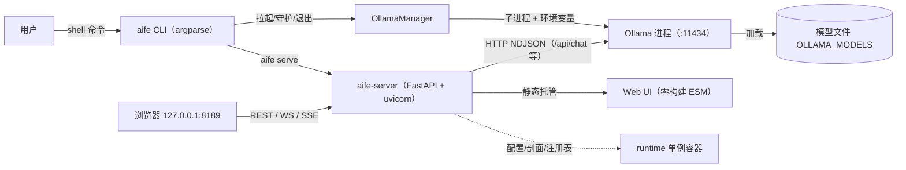
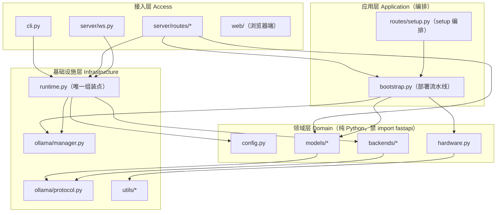

# AIE（AI For Everyone）技术架构设计 v1.0

- 版本：v1.0-errata1（v1.0-draft + errata1：OLLAMA_NUM_GPU 非环境变量勘误；env 白名单唯一权威源 = 03-ollama-accel.md §2.1）
- 作者：系统架构师 梁承宇
- 读者：主理人（高屋建）、Phase 2 专项设计（安智体/储海量/颜可心/程不宕/陆上线/凌无缺）、实现组
- 落盘路径：docs/design/02-architecture.md

## 0. 设计依据与来源

| 来源 | 内容 | 落点 |
|------|------|------|
| Octop 源码 E0/E1 确证事实 | 硬件剖面分离、后端抽象、一键部署分阶段、单一 YAML 配置、CLI、运行时容器、FastAPI 服务 | §1 架构总图、§4 模块清单、§9 落地映射 |
| Octop 逆向报告契约缺陷 | 错误码不统一、部分路由无错误处理、BackendHealth 非 pydantic 推导不出 OpenAPI schema | §5.1 统一错误规范、ADR-006 |
| Ollama 协议逆向事实 | /api/version\|tags\|ps\|chat\|generate\|pull\|show、NDJSON、OLLAMA_* 环境变量 | §5.2 路由表、§4 OllamaManager 配置 |
| ComfyUI 逆向报告 03 加速知识库 | fp8 门槛、注意力优先级、DynamicVRAM、NPU 无主线后端 | §3.3 加速知识映射（标注对 Ollama 适用性） |
| 任务书用户需求 1-6 与环境约束 | 一键部署、设备感知、CPU 可跑、依赖 ≤6、平台压缩包、每步可验证 | 全文，验证点见 §9「每步可验证结果」列 |

---

## 1. 产品定位与架构总图

### 1.1 产品定位

AIE = "AI For Everyone"，AI 能力本地化的一键部署方案。一条命令完成：硬件探测 → 依赖检查 → Ollama 安装与加速配置 → 模型拉取与验证 → 本地服务启动 → 浏览器即用。

- **一句话架构**：AIE 是本地大模型的「部署与运维平面」，Ollama 是「推理数据平面」，两者以本地 HTTP 协议松耦合；AIE 不替代、不嵌入推理引擎。
- **CPU 是一等公民**：验证机为 Windows + Intel Ultra 7 265K（无 NVIDIA、无 Ollama），CPU 路径必须完整可跑，架构不得假设 CUDA。
- **范围**：砍掉 ComfyUI 图像工作流，聚焦本地 LLM 部署、模型管理、对话、体检、压测。

### 1.2 进程模型



要点：
1. Ollama 为独立子进程，由 OllamaManager 注入环境变量（OLLAMA_HOST / OLLAMA_KEEP_ALIVE / OLLAMA_MAX_LOADED_MODELS…，完整白名单见 03-ollama-accel.md §2.1）、守护健康、崩溃自动拉起、随 aife 优雅退出。**注意：GPU 层卸载 num_gpu 不是环境变量**，只以请求级 `options.num_gpu`（/api/chat body）或 Modelfile `PARAMETER num_gpu` 生效，由 backends/ollama.py 在每次推理请求时注入。
2. aife-server 默认仅绑定 127.0.0.1（远程访问见【待确认】#4），本地单用户，无多租户。
3. 浏览器是唯一 UI 载体；CLI 覆盖脚本化/无头场景（chat、models、doctor、bench）。

### 1.3 分层架构与依赖方向



依赖规则（单向，禁止循环）：
- R1 接入层 → 应用层/领域层/基础设施层；**领域层不得 import fastapi/uvicorn 等框架细节**，保证无 GPU、无网络环境下可单测。
- R2 应用层只依赖领域层接口与基础设施层端口（manager 抽象），不依赖 HTTP 框架。
- R3 runtime.py 是唯一组装点（依赖注入容器），模块间禁止互相 import（backends 不知道 server 存在；protocol 不知道 backends 存在）。
- R4 确需反向通知时走事件总线（ws.py 广播），不走 import。

### 1.4 核心链路

**链路 A｜一键部署（aife setup）**
`cli.setup` → `runtime` 组装 → `bootstrap.run()` 分阶段执行：
`deps 检查 → hardware.probe() → resolve_profile() → ollama.ensure_installed()（缺失→按平台指引/分阶段重试）→ ollama.launch(env←profile，仅注入 env 白名单：OLLAMA_HOST / OLLAMA_KEEP_ALIVE / OLLAMA_MAX_LOADED_MODELS 等，不含 num_gpu) → catalog.recommend(profile) → models.pull(默认模型, 进度回调) → verify（deep health）`
- 每阶段可 `--skip-deps/--skip-ollama/--skip-model` 复跑；失败记录 last_error 并输出人工修复指引，绝不静默退出；可选加速件单独安装、失败不阻断主干（继承 octop bootstrap 设计）。

**链路 B｜对话（流式）**
浏览器 `POST /api/chat/stream` → `routes/chat.py`（try/except → 统一错误体）→ `BackendRegistry.current()` → `backends/ollama.py` → `OllamaClient.chat(stream=True)` → Ollama NDJSON 逐行 → 转 SSE 事件（delta/usage/done）→ 客户端渲染。backends/ollama.py 按 `ollama.num_gpu` 配置在请求 options 注入 num_gpu（请求级：改配置下一请求即生效，不触发 Ollama 重启）。后端不健康（含缺模型）→ 503 `BACKEND_UNHEALTHY` 或按 fallback 链重试。

**链路 C｜模型拉取**
`POST /api/models/pull` → 创建内存态 task（重复拉取返回 409 `PULL_IN_PROGRESS`）→ Ollama `/api/pull` NDJSON 进度 → WS `model.pull_progress` → `model.pull_done` / `setup.error`。

**链路 D｜健康检查**
`GET /api/health/deep` → 并发探测（aife 版本/uptime、Ollama /api/version、/api/ps 已加载模型、当前后端健康（缺模型=不健康）、磁盘余量）→ pydantic `HealthReport`（恒返回 200，healthy 字段表达结论，失败项进 checks）。`GET /api/health` 为 liveness 探活。

---

## 2. 目录结构设计（代码实现蓝本）

```
aife/                                       # 仓库根 = GitHub 上传包根
├── pyproject.toml                         # 打包元数据；核心依赖 ≤6（fastapi/uvicorn/httpx/pydantic/PyYAML/websockets）
├── README.md                              # 快速开始 + 三平台安装说明 + 目录导览
├── LICENSE                                # MIT（GitHub 上传包合规）
├── .gitignore                             # 忽略 .aie/、logs/、dist/、venv
├── aife/                                   # 主包（import aife）
│   ├── __init__.py                        # __version__ 与公共导出
│   ├── __main__.py                        # python -m aife 入口（转发 cli.main）
│   ├── cli.py                             # argparse 子命令：setup/doctor/serve/chat/models/backend/bench/version
│   ├── config.py                          # 单一 YAML 源：加载/${VAR} 展开/pydantic 校验/reload 热切换
│   ├── runtime.py                         # 进程级单例容器：组装 config/hardware/registry/ollama_manager（唯一组装点）
│   ├── hardware.py                        # probe_devices 探测降级链 + VendorProfile×7 + resolve_profile 缝合
│   ├── bootstrap.py                       # 一键部署流水线：阶段化/可跳过/失败指引/进度回调
│   ├── backends/
│   │   ├── __init__.py                    # BackendRegistry：注册/热切换/fallback 链/last_errors
│   │   ├── base.py                        # LLMBackend 抽象：chat/stream/health/close + complete_json 工具方法
│   │   ├── ollama.py                      # Ollama 后端：NDJSON 流式；健康检查含「缺模型判不健康」
│   │   └── openai_compat.py               # OpenAI 兼容后端（远程/混合场景，可选启用）
│   ├── ollama/
│   │   ├── __init__.py
│   │   ├── manager.py                     # Ollama 安装检测/启动/守护/环境变量生成/优雅退出
│   │   └── protocol.py                    # Ollama HTTP 客户端：version/tags/ps/chat/generate/pull/show
│   ├── models/
│   │   ├── __init__.py
│   │   ├── catalog.py                     # 模型目录：设备能力→推荐档位（CPU 小模型优先）
│   │   └── manager.py                     # 模型拉取（任务态/进度/防重）/校验/删除/本地列表
│   ├── server/
│   │   ├── __init__.py                    # create_app() 工厂导出
│   │   ├── app.py                         # FastAPI 工厂：中间件/异常处理器/静态挂载/本地 CORS
│   │   ├── errors.py                      # 统一错误码枚举 + AIEError 异常体系 + 错误体 schema
│   │   ├── schemas.py                     # 全部 pydantic 请求/响应模型（含 HealthReport/BackendHealth）
│   │   ├── deps.py                        # 依赖注入：从 runtime 取 registry/manager（测试可 mock）
│   │   ├── ws.py                          # WS /ws/events 事件总线：广播 + 30s 心跳
│   │   └── routes/
│   │       ├── __init__.py                # 汇总 include_router
│   │       ├── health.py                  # GET /api/health、/api/health/deep
│   │       ├── system.py                  # GET /api/system、/api/hardware、GET/PATCH /api/config
│   │       ├── models.py                  # GET /api/models、/available；POST /pull；DELETE /{name}
│   │       ├── chat.py                    # POST /api/chat、/api/chat/stream（SSE）
│   │       ├── backends.py                # GET /api/backends；POST /api/backends/select
│   │       ├── setup.py                   # POST /api/setup/run；GET /api/setup/status
│   │       └── ollama.py                  # POST /api/ollama/restart（运维动作）
│   ├── web/
│   │   ├── index.html                     # 零构建 ESM 单页外壳（四视图：向导/聊天/模型/状态）
│   │   ├── app.js                         # ESM 入口：视图路由/轻量 store/WS 订阅
│   │   ├── api.js                         # fetch 封装：统一错误体解析 + SSE 读取
│   │   ├── style.css                      # 样式（无 CSS 框架）
│   │   └── pages/
│   │       ├── wizard.js                  # 部署向导：触发 setup、展示 WS 进度与修复指引
│   │       ├── chat.js                    # 聊天：SSE 流式渲染、模型切换、参数面板
│   │       ├── models.js                  # 模型管理：已装列表/推荐目录/拉取/删除
│   │       └── status.js                  # 状态：硬件剖面/后端/深度健康
│   └── utils/
│       ├── __init__.py
│       ├── logging.py                     # 日志：控制台+滚动文件；trace_id 注入
│       └── platform.py                    # 跨平台：路径解析（相对可迁移）/进程管理/权限检测
├── scripts/
│   ├── install-windows.ps1                # Windows：Python 检测/venv/装依赖/快捷方式
│   ├── install-linux.sh                   # Linux：同上 + Ollama 安装检测
│   ├── install-macos.sh                   # macOS（含 Apple Silicon）：同上
│   └── build-release.sh                   # 打包：源码 tar.gz + 三平台 zip（GitHub Release 资产）
├── tests/                                 # pytest：全部可在无 GPU、无 Ollama、无网络机器运行
│   ├── conftest.py                        # fixtures：临时 .aie 目录/mock Ollama HTTP
│   ├── test_config.py                     # YAML 展开/校验失败/热切换
│   ├── test_hardware.py                   # 探测降级链：CPU 兜底/工具缺失/mock nvidia-smi
│   ├── test_backend_contract.py           # 后端契约 + 缺模型不健康 + fallback 链
│   ├── test_ollama_protocol.py            # NDJSON 解析/错误映射（mock HTTP）
│   ├── test_errors.py                     # 错误码/错误体 schema 快照
│   └── test_server_api.py                 # TestClient 全路由 + 统一错误体断言
├── docs/
│   └── design/
│       ├── 01-requirements.md             # 需求文档（PM 产出）
│       ├── 02-architecture.md             # 本文档
│       └── 03-api-contract.md             # OpenAPI 导出 + 事件字典（Phase 2 细化）
└── .github/
    └── workflows/
        └── ci.yml                         # CI：lint + pytest，win/linux/macos matrix，无 GPU runner

```

---

## 3. 技术选型

### 3.1 选型总表

| 领域 | 主选方案 | 备选（被否决） | 否决原因 | 适用前提 |
|------|---------|--------------|---------|---------|
| Web 框架 | FastAPI + uvicorn | Flask / aiohttp / Node+Fastify | Flask 无原生异步、类型校验与自动 OpenAPI，契约治理成本高；aiohttp 生态与 schema 弱；引入 Node 双运行时违背「Python 单栈 + 依赖少」 | 需自动 OpenAPI 与 pydantic 响应模型修正 octop 契约缺陷 |
| HTTP 客户端 | httpx（异步+连接池） | requests / aiohttp | requests 同步无法高效处理 NDJSON/SSE 长连接；aiohttp 与 FastAPI 功能重复 | 需流式调用 Ollama |
| 配置 | 单一 YAML + ${VAR} 展开 + pydantic v2 校验 | pydantic-settings / TOML / 纯环境变量 | pydantic-settings 多源优先级隐晦，不利「单一真相源」治理；TOML/JSON 无注释友好度与变量展开约定 | 配置需人读、可评审、可整文件迁移 |
| 模型推理 | Ollama 子进程（进程外管理） | llama-cpp-python 嵌入 / vLLM / TGI | 嵌入使 GPU 生命周期绑定主进程、分发体积暴增；vLLM/TGI 重 GPU、CPU 不可跑，违反「CPU 一等公民」 | Ollama 已封装 CUDA/ROCm/Vulkan/CPU/Metal，协议事实已确证 |
| 硬件探测 | 系统工具优先 + torch 惰性导入 | torch 硬依赖 / nvidia-ml-py 硬依赖 | torch/nvidia-ml-py 体积大且国内拉取失败时主程序无法启动，违反「裸机可跑」 | 降级链：nvidia-smi > torch > rocm-smi > PnP NPU > MPS > CPU 兜底 |
| Web UI | 零构建原生 ESM（无打包器/无框架） | React/Vue + Vite | 构建链把 node_modules 与构建步骤带入分发与维护，违背「压缩包可直跑 + 依赖少 + 单人可维护」；四视图交互轻，原生 ESM 足够 | UI 限于向导/聊天/模型/状态（重构触发条件见 §10） |
| 前后端通信 | REST + 原生 WebSocket + SSE | Socket.io / GraphQL / gRPC-Web | GraphQL/gRPC-Web 对本地单用户工具过度设计；Socket.io 需 Node 服务端 | 事件单向推送 + 请求响应 |
| CLI | argparse（标准库） | click / typer / fire | 子命令仅 8 个、参数简单；标准库零依赖可控可测，守住依赖预算 ≤6 | 依赖预算是硬约束 |
| 打包分发 | 平台 zip（源码 + venv 引导脚本） | PyInstaller 单文件 / Docker | PyInstaller 构建慢（含 fastapi 生态常 10 分钟级）、杀软误报、体积失控、难调试；Docker 在 Windows 桌面体验差 | 交付物明确要求「各平台压缩包 + GitHub 上传包」 |
| 流式协议 | Ollama NDJSON → SSE 转换透传 | 自定义二进制帧 | 与 Ollama 协议一致，降低排障与迁移成本；SSE 对浏览器原生友好 | 聊天流式场景 |

**核心依赖清单（≤6）**：`fastapi`、`uvicorn`、`httpx`、`pydantic`、`PyYAML`、`websockets`。`torch` 仅为探测惰性导入，非硬依赖；其余一律标准库。

### 3.2 分层职责速查

| 层 | 模块 | 职责 | 依赖方向 | 技术栈 |
|----|------|------|---------|--------|
| 接入层 | cli.py | 子命令解析、参数校验、退出码 | → runtime | argparse |
| 接入层 | server/routes/* | HTTP 契约、编排调用、错误映射 | → runtime/bootstrap/models | FastAPI |
| 接入层 | server/ws.py | 事件广播总线 | → runtime | websockets |
| 应用层 | bootstrap.py | 部署流水线阶段编排 | → hardware/ollama/models | 纯 Python |
| 领域层 | config.py | 配置真相源 | 无内部依赖 | PyYAML+pydantic |
| 领域层 | hardware.py | 探测与剖面 | → utils | 标准库+惰性 torch |
| 领域层 | backends/* | 后端抽象与注册 | → ollama/protocol | httpx |
| 领域层 | models/* | 目录推荐与拉取管理 | → ollama/protocol | httpx |
| 基础设施层 | runtime.py | 单例组装 | → 全部领域层 | 纯 Python |
| 基础设施层 | ollama/* | 进程管理与协议客户端 | → utils/platform | httpx+subprocess |

### 3.3 硬件加速知识映射（来自 ComfyUI 逆向，标注对 Ollama 适用性）

| 加速事实 | 来源 | 对 AIE（Ollama/llama.cpp）适用性 | AIE 处置 |
|---------|------|------|------|
| fp8 需 NVIDIA SM≥8.9 | ComfyUI 逆向 03 | **不直接适用**：Ollama 用 llama.cpp 后端，模型量化由发布者决定（Q4_K_M 等），与 ComfyUI 扩散 fp8 无关 | catalog 只按量化档位标注体积/质量，不按 SM 门槛过滤 |
| 注意力 sage>flash>xformers>sdpa | ComfyUI 逆向 03 | **不适用**：llama.cpp 自有 attention 实现，由 Ollama 构建决定 | 不透出该配置 |
| DynamicVRAM 需 torch≥2.8 | ComfyUI 逆向 03 | **不适用**：ComfyUI 特有显存管理 | 忽略 |
| NPU 主线无后端 | ComfyUI 逆向 03 | **适用**：Ollama 主线同样只有 CUDA/ROCm/Vulkan/CPU/Metal，无 NPU 后端 | Intel NPU 设备 → 剖面 caveats 明示，推理走 CPU 路径 |
| AMD ROCm 需 6.4+/torch 2.7+ | ComfyUI 逆向 03 | **部分适用**：Ollama ROCm 版有独立版本矩阵（主要 Linux） | 剖面分 amd_rocm（Linux）与 Windows Vulkan/DirectML 路径；caveats 注明 |
| CPU 永远兜底 | octop 事实 | **完全适用** | 剖面优先级末位 CPU；验证机即此路径 |

---

## 4. 模块职责与关键配置项清单

| 模块 | 职责 | 配置键 | 默认值 | 校验规则 |
|------|------|--------|--------|---------|
| config.py | 单一 YAML 加载/展开/校验/热切换 | config.path | ~/.aife/config.yaml | 文件存在可读；不存在则用默认值并生成模板 |
| hardware.py | 探测设备 + 剖面求解 | hardware.device | "auto" | enum[auto,cuda,rocm,xpu,mps,directml,npu,cpu]；auto 按 CUDA>ROCM>XPU>MPS>DirectML>NPU>CPU 求解 |
| hardware.py | 显存档位（探测填充） | hardware.vram_gb | null | >0 或 null |
| ollama/manager.py | Ollama 安装检测/启动/守护/退出 | ollama.host | "127.0.0.1" | IP 或主机名 |
| 同上 | 端口 | ollama.port | 11434 | 1–65535 |
| 同上 | 随 aife 自动拉起 | ollama.autostart | true | bool |
| 同上 | 模型驻留时长 | ollama.keep_alive | "5m" | 时长串（Nd/Nh/Nm/Ns） |
| 同上 | GPU 层卸载 | ollama.num_gpu | -1 | int；-1=自动 |
| 同上 | 最大同时加载模型数 | ollama.max_loaded_models | 1 | 1–8（按内存约束） |
| models/catalog.py | 设备能力→推荐档位 | models.default | null | null 时按剖面推荐；非 null 须在 catalog 或已安装 |
| models/manager.py | 拉取/校验/删除 | models.max_concurrent_pull | 1 | 1–4 |
| backends/registry | 当前后端 | backends.active | "ollama" | enum[ollama,openai_compat] |
| 同上 | 回退链 | backends.fallback | ["ollama"] | 非空；元素 ∈ 已注册后端 |
| server/app.py | 绑定地址 | server.host | "127.0.0.1" | IP 或主机名 |
| 同上 | 端口 | server.port | 8189 | 1–65535，≠ ollama.port |
| 同上 | 日志级别 | server.log_level | "info" | enum[debug,info,warning,error] |
| 同上 | serve 后自动开浏览器 | server.open_browser | true | bool |
| bootstrap.py | 可跳过阶段 | setup.skip | [] | 元素 ∈ [deps,ollama,model] |
| bench | 压测时长 | bench.duration_s | 30 | >0 |

配置样例骨架（契约定型，不写实现）：

```yaml
config_version: 1
hardware:
  device: auto            # auto 由 resolve_profile 求解
  vram_gb: null           # 探测填充，只读展示
ollama:
  host: 127.0.0.1
  port: 11434
  autostart: true
  keep_alive: 5m
  num_gpu: -1             # -1 自动分层卸载
  max_loaded_models: 1
models:
  default: null           # null = 按剖面从 catalog 推荐
  max_concurrent_pull: 1
backends:
  active: ollama
  fallback: [ollama]
server:
  host: 127.0.0.1
  port: 8189
  log_level: info
  open_browser: true
openai_compat:            # 仅当 backends.active=openai_compat 时启用
  base_url: ${AIE_OPENAI_BASE_URL:-}
  api_key: ${AIE_OPENAI_API_KEY:-}   # 密钥只引用环境变量，不落明文
```

---

## 5. 接口契约框架

### 5.1 统一错误规范（修正 octop 已证缺陷）

HTTP 状态码语义表：

| 状态码 | 语义 | 典型 code |
|--------|------|-----------|
| 400 | 参数/校验失败 | VALIDATION、CONFIG_INVALID、STEP_INVALID、MODEL_INVALID_NAME、BACKEND_UNKNOWN |
| 404 | 资源不存在 | MODEL_NOT_FOUND、SETUP_NOT_FOUND、ROUTE_NOT_FOUND |
| 409 | 状态冲突 | PULL_IN_PROGRESS、SETUP_RUNNING |
| 429 | 限流 | RATE_LIMITED |
| 500 | 服务内部错误 | INTERNAL_ERROR |
| 503 | 上游/依赖不可用 | OLLAMA_UNAVAILABLE、BACKEND_UNHEALTHY、MODEL_NOT_LOADED |
| 504 | 上游超时 | UPSTREAM_TIMEOUT |

错误体 schema（所有错误响应一致，content-type: application/json）：

```json
{
  "error": {
    "code": "MODEL_NOT_FOUND",
    "message": "model 'qwen2.5:7b' is not installed",
    "details": { "model": "qwen2.5:7b", "installed": ["qwen2.5:3b"] },
    "trace_id": "0f4b8c2e-7c1a-4f3e-9b2d-1a2b3c4d5e6f"
  }
}
```

规范要点：
1. 成功响应不带 error 字段；失败响应必须符合上述 schema；WS/SSE 通道内的错误也序列化为同构事件（type: "error" + 同 error 体）。
2. code 为稳定机器可读标识（大写蛇形 DOMAIN_REASON），客户端只依赖 code，不依赖 message 文案。
3. **全路由 try/except**：路由函数内捕获领域异常 → 映射为 AIEError；中间件兜底未捕获异常 → 500 INTERNAL_ERROR；响应头 X-Trace-Id 与日志 trace_id 一致；堆栈只进日志，不进响应（修正 octop 部分路由无错误处理）。
4. **所有响应模型均为 pydantic BaseModel**（含 HealthReport、BackendHealth），OpenAPI schema 完整可导出（修正 octop BackendHealth 非 pydantic 缺陷）。

### 5.2 REST 路由表（草案）

| API | 方法 | 入参 | 出参 | 同步/异步 | 错误码 |
|-----|------|------|------|----------|--------|
| /api/health | GET | — | {status, version, uptime_s} | 同步 | 500 |
| /api/health/deep | GET | — | HealthReport{healthy, checks:{aife,ollama,models,backend,disk}}（恒 200，healthy 表达结论） | 同步（内部并发探测） | 500 |
| /api/system | GET | — | SystemInfo{version, platform, python, ollama_version, profile, active_backend} | 同步 | 503 OLLAMA_UNAVAILABLE |
| /api/hardware | GET | — | HardwareReport{devices[], profile, source} | 同步 | 500 |
| /api/config | GET | — | ConfigView（脱敏：密钥打码） | 同步 | 500 |
| /api/config | PATCH | 部分配置体 | ConfigView | 同步（热切换） | 400 CONFIG_INVALID |
| /api/models | GET | — | {models:[ModelInfo{name,size,family,parameter_size,quantization,modified_at}]} | 同步 | 503 OLLAMA_UNAVAILABLE |
| /api/models/available | GET | query: device_profile? | {models:[CatalogEntry{name,size_gb,min_ram_gb,tags,recommended_for}]} | 同步 | 400 |
| /api/models/pull | POST | {name} | {task_id}（202） | 异步（WS 进度） | 400 MODEL_INVALID_NAME、409 PULL_IN_PROGRESS、503 |
| /api/models/{name} | DELETE | — | {deleted:true} | 同步 | 404 MODEL_NOT_FOUND、503 |
| /api/chat | POST | {model?, messages, options?} | {message, usage, done} | 同步 | 400、404 MODEL_NOT_FOUND、503 BACKEND_UNHEALTHY、504 UPSTREAM_TIMEOUT |
| /api/chat/stream | POST | 同上 | SSE：delta/usage/done/error 事件 | 异步（SSE） | 同上（预检失败先返 4xx/5xx，流中错误以 error 事件） |
| /api/backends | GET | — | {active, chain[], health{name,healthy,detail}} | 同步 | 500 |
| /api/backends/select | POST | {name, force?} | {active:name} | 同步 | 400 BACKEND_UNKNOWN、503 BACKEND_UNHEALTHY（force=true 豁免） |
| /api/setup/run | POST | {steps?, skip?} | {run_id,status}（202） | 异步（WS 进度） | 400 STEP_INVALID、409 SETUP_RUNNING |
| /api/setup/status | GET | — | {run_id, steps[{name,status,started_at,finished_at,error?}], current} | 同步 | 404 SETUP_NOT_FOUND |
| /api/ollama/restart | POST | — | {restarted:true} | 同步 | 503 OLLAMA_UNAVAILABLE |

### 5.3 WS 事件契约（/ws/events）

单连接全量广播；服务端 30s 心跳。事件信封统一：

```json
{ "type": "model.pull_progress", "ts": "2025-01-01T00:00:00Z", "payload": { "task_id": "…", "completed": 1200000000, "total": 4700000000 } }
```

| 事件 | 触发时机 | payload |
|------|---------|---------|
| setup.started | setup 流水线开始 | {run_id, steps[]} |
| setup.step_progress | 阶段内进度 | {run_id, step, message} |
| setup.step_done | 阶段完成 | {run_id, step, duration_ms} |
| setup.error | 阶段失败 | {run_id, step, code, message, remedy} |
| model.pull_progress | Ollama /api/pull 进度 | {task_id, status, completed, total} |
| model.pull_done | 拉取完成 | {task_id, model} |
| log.line | 日志（受 log_level 控制） | {level, logger, message, ts} |
| backend.changed | 后端切换/回退 | {active, reason} |
| health.changed | 深度健康结论变化 | {healthy, failed_checks[]} |
| error | 通道内错误 | 统一 error 体 |
| heartbeat | 30s | {} |

### 5.4 CLI 子命令表

| 子命令 | 用途 | 关键参数 | 输出/退出码 |
|--------|------|---------|------------|
| aife setup | 一键部署 | --skip-deps --skip-ollama --skip-model --model NAME --dry-run --serve --config PATH | 分阶段进度+修复指引；成功 0 |
| aife doctor | 环境体检 | --json | 逐项结论+建议；异常项非 0 |
| aife serve | 启动服务 | --host --port --no-browser | 访问 URL；Ctrl-C 优雅退出 |
| aife chat | 命令行对话 | --model M -m MSG --stream | 文本/流式输出 |
| aife models | 模型管理 | list / pull NAME / rm NAME / show NAME | 列表/进度/结果 |
| aife backend | 后端管理 | list / use NAME / doctor | 状态表 |
| aife bench | 本地压测 | --model M --duration S --concurrency N | tok/s、TTFT、错误率报告 |
| aife version | 版本 | — | 版本+commit |

注：octop 的 plan（预演）并入 `aife setup --dry-run`；run（一次性推理）并入 `aife chat -m`。

---

## 6. 非功能性目标

| 维度 | 目标 | 实现手段 | 验证方式 |
|------|------|---------|---------|
| 冷启动 | 任意 CLI 子命令 P50 < 0.8s；aife serve 到可接受请求 < 3s | 惰性导入（torch/httpx 按需）；路由模块化；不预热模型 | CI 启动基准 + 人工秒表 |
| 内存 | aife-server 稳态 RSS < 150MB（不含 Ollama） | 无 numpy/torch 常驻；流式不全量缓冲；任务内存态 | CI RSS 采样断言 |
| 可移植性 | 整个 .aife 目录可拷贝迁移；无绝对路径硬编码 | 配置单 YAML；日志相对路径；OLLAMA_MODELS 可指向可配置路径 | 迁移测试：换路径后 doctor 全绿 |
| 可维护性 | 无 GPU、无 torch、无网络环境下 pytest 全绿 | torch 惰性+探测降级；backends 可 mock Ollama | CI matrix（win/linux/macos，无 GPU runner） |
| 可用性 | Ollama 崩溃 5s 内自动拉起（退避 3 次）；配置热切换不重启 aife-server | OllamaManager 守护；reload()；backend fallback | 故障注入测试（kill -9 Ollama） |
| 安全 | 默认仅 127.0.0.1；密钥只经 ${VAR} 引用；错误响应不泄露堆栈 | 绑定默认本地；统一错误体；trace_id 关联日志 | 安全 checklist + 错误响应快照测试 |
| 成本 | 模型推理零边际成本（本地）；分发产物 ≤ 30MB（不含模型） | 不内嵌模型；按需拉取 | CI 产物大小断言 |

---

## 7. 数据流转与存储概要（详细建模交储海量）

| 数据 | 存储 | 分工说明 |
|------|------|---------|
| 配置文件 | ~/.aife/config.yaml（单文件，config_version=1） | 唯一真相源；密钥用 ${VAR} 引用不入明文；可整文件迁移/回滚 |
| 模型文件 | Ollama 自管（OLLAMA_MODELS，默认 ~/.ollama/models） | AIE 不复制/不托管模型文件，只发指令；迁移需单独处理大体量 |
| 日志 | ~/.aife/logs/aife.log（滚动 10MB×5） | trace_id 贯穿请求→WS→日志 |
| 运行时状态 | 内存态（runtime 单例） | 后端注册表、pull 任务、setup run；进程退出即重置，不持久化 |
| 业务数据 | 无数据库 | 本地单用户工具；会话历史等见 §10 演进触发条件 |
| 遥测 | 无（默认关闭） | 见【待确认】#10 |

---

## 8. 关键设计决策记录（ADR）

**ADR-001｜Ollama 进程外管理（子进程）而非嵌入 llama-cpp-python**
- 决策：OllamaManager 拉起并守护独立 Ollama 进程，经本地 HTTP 协议通信。
- 备选：llama-cpp-python 嵌入主进程；自研推理服务。
- 理由：① 推理引擎崩溃（GPU 上下文）不拖垮 aife-server；② Ollama 已封装 CUDA/ROCm/Vulkan/CPU/Metal 与模型管理，三平台一致；③ 模型与引擎版本升级独立于 AIE 发布；④ CPU 机器零编译成本。
- 后果：多一个进程依赖与安装步骤（国内网络需分阶段重试）；需实现守护、环境变量注入、优雅退出。

**ADR-002｜CPU 一等公民：探测降级链 + CPU 后端 + 小模型推荐**
- 决策：探测按「实测优先、工具次之、推断最后」，CPU 永远兜底；剖面优先级 CUDA>ROCM>XPU>MPS>DirectML>NPU>CPU；无 GPU 时 Ollama 以 CPU 后端启动，catalog 默认推荐 3B 级量化模型；torch 惰性导入。
- 备选：GPU-only 后期补 CPU；torch 硬依赖探测。
- 理由：验证机即纯 CPU；torch 拉取失败时主程序必须仍可启动；国内用户 NVIDIA 占比低于全球平均。
- 后果：需维护「内存/显存 → 模型档位」映射并在 UI 明示低端设备预期（tok/s 量级）。

**ADR-003｜单一 YAML 配置源 + 运行时热切换**
- 决策：~/.aife/config.yaml 唯一源 + ${VAR} 展开 + pydantic v2 校验；PATCH /api/config 触发 runtime.reload()，后端/剖面热生效不重启；涉及 Ollama 启动参数的变更以「重启 Ollama 子进程」落实（aife-server 不动）。
- 备选：pydantic-settings 多源；环境变量唯一；改配置必须重启。
- 理由：单一真相源可整文件评审/迁移/回滚；换模型/换后端是高频操作；octop 已验证可行。
- 后果：reload 需校验失败即拒绝并保留旧配置；schema 版本化（config_version）以备迁移。

**ADR-004｜零构建原生 ESM 前端**
- 决策：web/ 为原生 ES Module 单页（index.html + app.js + pages/*.js），无 npm/无打包器/无框架，FastAPI 静态托管；通信走 fetch + 原生 WebSocket + SSE。
- 备选：React/Vue + Vite。
- 理由：交付物是「压缩包可直跑」；构建链把 node_modules 与构建步骤带入分发；四视图交互轻；单人可维护。
- 后果：无组件生态与 HMR，靠模块化约定控复杂度；重构触发条件见 §10。

**ADR-005｜zip + 平台脚本分发（非 PyInstaller 单文件/非 Docker）**
- 决策：分发物为平台压缩包（源码 + pyproject + scripts/install-*），安装脚本负责 venv/依赖/命令注册；GitHub Release 提供三平台 zip + 源码 tar.gz。
- 备选：PyInstaller 单文件；Docker 镜像。
- 理由：PyInstaller 构建慢、杀软误报、体积失控、难调试；Docker 在 Windows 桌面体验差；zip+venv 与「依赖 ≤6 + Python ≥3.10」自洽且源码可审计。
- 后果：用户需 Python 3.10+（脚本检测并给指引）；三平台安装脚本需维护与 CI 覆盖。

**ADR-006｜统一错误契约（修正 octop 已证缺陷）**
- 决策：统一错误体 schema + DOMAIN_REASON 错误码 + 全路由 try/except + pydantic 响应模型。
- 备选：维持 octop 式各路由自返回。
- 理由：octop 逆向实证错误码不统一、部分路由无错误处理、BackendHealth 非 pydantic 致 OpenAPI 缺失，前端与 CLI 无法稳定消费。
- 后果：errors.py 集中治理 + 快照测试；新路由从 schemas/errors 复用契约模板。

**ADR-007｜硬件探测：系统工具优先 + torch 惰性导入**
- 决策：nvidia-smi 实测 → torch.cuda（惰性）→ rocm-smi → PnP NPU 枚举 → MPS → CPU 兜底；7 家 VendorProfile 固化 ollama_accel/env/caveats；HardwareReport 带 source 证据等级。
- 备选：torch 硬依赖；仅 nvidia-smi。
- 理由：裸机必须能跑 doctor/serve；torch 只补 SM 架构与显存细粒度。
- 后果：探测精度分档，UI 需展示「实测/推断」来源。

---

## 9. 对 Octop 的落地映射表

| Octop 模块（事实来源） | AIE 模块 | 动作 | 落地说明 | 每步可验证结果 |
|------------------------|----------|------|---------|---------------|
| hardware.py（probe_devices/VendorProfile×7/resolve_profile） | aife/hardware.py | 继承+改造 | 删 comfy_args；增 ollama_accel 与 min_ram_gb；caveats 保留 | test_hardware：CPU 兜底/降级链全绿 |
| backends/（LLMBackend/Ollama/OpenAI compat/Registry+fallback） | aife/backends/ | 继承+修正 | 健康检查强制「缺模型判不健康」（M14 教训）；返回全 pydantic | test_backend_contract：缺模型→unhealthy；fallback 链生效 |
| bootstrap.py（分阶段/可跳过/失败指引） | aife/bootstrap.py | 继承+改造 | 删 --no-comfy；阶段改 deps→ollama→model→verify | aife setup --skip-deps 在无网机器可复跑 |
| config.py（YAML+${VAR}+pydantic） | aife/config.py | 继承 | 增 config_version 与 reload() | test_config：展开/校验失败/热切换 |
| cli.py（setup/doctor/serve/plan/run/backend/bench） | aife/cli.py | 继承+扩展 | 砍 plan/run（并入 --dry-run/-m）；增 models/chat | aife --help 八子命令；doctor --json 可解析 |
| runtime.py（进程单例组装） | aife/runtime.py | 继承+改造 | ComfyUI 桥接 → OllamaManager | 单例组装无循环 import（CI import-lint） |
| server/app.py（FastAPI REST+WS） | aife/server/ | 继承+重构 | 拆 routes/；统一错误契约；静态托管 ESM UI | test_server_api：全路由+错误体快照 |
| ComfyUI 桥接/图像工作流 | — | 砍掉 | 全部移除（配置键/文档/依赖） | grep 无 comfy 残留 |
| — | aife/ollama/{manager,protocol}.py | 新增 | 安装检测/环境变量/守护；version/tags/ps/chat/generate/pull/show | mock Ollama：NDJSON 解析与错误映射 |
| — | aife/models/{catalog,manager}.py | 新增 | 能力→推荐档位；拉取任务态/进度/防重 | pull 进度事件序列正确；重复 pull→409 |
| — | aife/web/（ESM） | 新增 | 向导/聊天/模型/状态四视图 | 浏览器手工验收 checklist |
| — | scripts/ + .github/workflows/ci.yml | 新增 | 三平台安装/打包；无 GPU CI matrix | 三平台 venv 安装冒烟通过 |
| — | aife/utils/{logging,platform}.py | 新增 | 跨平台路径/进程；trace_id 日志 | 路径迁移测试 + trace_id 关联断言 |

---

## 10. 演进路径与风险

### 10.1 演进路径

| 触发条件 | 演进动作 | 成本估计 |
|----------|---------|---------|
| 家庭/办公室共享（并发用户 >1） | server.host 支持 0.0.0.0 + token 鉴权 + 会话隔离 | 中 |
| 需要会话历史/收藏提示词 | 引入 SQLite（stdlib sqlite3，不增依赖） | 低-中 |
| 前端视图 >6 或出现实时协作/可视化编排 | web/ 引入 Vite+框架构建链，重构为 src/ | 中 |
| 多机管理需求 | 抽出 agent 模式（aife --agent 注册中心）；API 版本化 /api/v1 | 高 |
| Ollama 不满足某硬件（如 NPU） | backends 增加新后端（契约已预留，如 OpenVINO 路线） | 中 |
| 插件生态诉求 | 后端/模型源插件化（importlib entry_points） | 中 |

### 10.2 架构风险

| 风险 | 影响 | 缓解 |
|------|------|------|
| Ollama 主线无 NPU 后端 | Intel NPU 机无法 NPU 加速 | 剖面 caveats 明示；CPU 兜底；OpenVINO 路线记入演进 |
| Ollama 安装依赖网络/权限（Windows PATH/管理员） | 一键部署断点 | 分阶段重试 + 手动指引；doctor 检测安装态 |
| AMD 矩阵复杂（ROCm 主要 Linux；Win AMD 走 Vulkan） | 加速档位误判 | 剖面分 amd_rocm/amd_directml；探测读 rocm-smi/PnP 证据 |
| 零构建前端复杂度蔓延 | 后期不可维护 | pages/ 模块化 + §10.1 触发条件 |
| 配置热切换与 Ollama 启动参数不一致 | 改了不生效 | reload 比对派生 env，变更则重启 Ollama 子进程并广播 health.changed |
| torch 惰性导入掩盖真实 GPU 能力 | 剖面精度下降 | HardwareReport.source 标注证据等级；doctor 建议装 torch 补精度 |

### 10.3 【待确认】

1. 【待确认】最终命令名/包名：aife vs aie vs ai-for-everyone（影响 pyproject/脚本/文档）。
2. 【待确认】默认模型目录与分档表（CPU 3B 档、8GB/16GB 档各自默认模型与量化）——需 PM + 实测定版，影响 models/catalog 首版实现。
3. 【待确认】Ollama 安装方式优先级：包管理器（winget/brew/apt）vs 官方 installer vs 内置绿色版解压（国内网络与杀软考虑），影响 bootstrap 首阶段。
4. 【待确认】是否支持远程访问（0.0.0.0 + token 鉴权）——影响 server.host 默认与安全设计。
5. 【待确认】Ollama 最低支持版本与端点可用性矩阵（/api/ps 等）。
6. 【待确认】Apple Silicon 统一内存下的模型档位与 num_gpu 语义。
7. 【待确认】配置目录策略：~/.aife（用户级）vs 可执行同级（便携优先）——影响「压缩包可直跑」叙事。
8. 【待确认】v1 UI 语言范围（仅简体中文？）与暗色模式。
9. 【待确认】bench 验收指标（tok/s、TTFT 阈值）——需 PM 定义「可接受体验」。
10. 【待确认】匿名使用统计遥测（默认关，需确认是否规划）。

---

## 11. 主理人裁决记录（Phase 2 开工前，高屋建）

| # | 待确认项 | 裁决 | 理由 |
|---|---|---|---|
| D7（对应 §10.3-1） | 命令名/包名 | **包名与命令名统一为 `aife`**（import aife；CLI `aife`）。本文正文中「aie」字样均指同一产品，实现以 `aife` 为准 | 与需求文档 D5 一致；产品名 AI For everyone 的自然缩写；避免双名歧义 |
| D8（对应 §10.3-2） | 默认模型分档表 | **CPU 档默认 `qwen2.5:3b`**；分档：RAM<8GB → `qwen2.5:1.5b`；8–16GB → `qwen2.5:3b`；16–32GB → `qwen2.5:7b`；>32GB 或 GPU VRAM≥12GB → `qwen2.5:14b`；GPU VRAM≥8GB 且 <12GB → `qwen2.5:7b`。量化默认跟随 Ollama 官方 tag（Q4_K_M 量级） | 中文效果/体积/许可综合；catalog 表由安智体在专项设计中定稿 |
| D9（对应 §10.3-3） | Ollama 安装方式优先级 | **包管理器优先、官方安装脚本兜底、手动指引收尾**：Windows → winget（无则官方 .exe 指引）；macOS → brew（无则 .dmg 指引）；Linux → 官方 install.sh（apt 存在时提示 Ollama 不在官方源的现实） | 幂等、进 PATH、可回滚；继承 octop「不静默下载、失败给指引」基因 |
| D10（对应 §10.3-4） | 远程访问 | **MVP 默认仅 127.0.0.1**；`server.host` 可配 0.0.0.0 但 README 明示风险，不做 token 鉴权（列入演进 §10.1） | 单用户本地工具；鉴权重型方案超出 MVP |
| D11（对应 §10.3-5） | Ollama 版本矩阵 | **最低支持 v0.5.0**（/api/version、/api/tags、/api/chat、/api/pull 均稳定）；doctor 对 <0.5.0 明确报不支持并给升级命令；`/api/ps` 缺失时降级为「不探测已加载模型」而非报错 | 版本兼容矩阵兜住「参数拼错静默失败」类问题（继承 octop doctor 基因） |
| D12（对应 §10.3-6） | Apple Silicon | **统一内存按总 RAM 分档**（同 D8 表）；Metal 后端下不设 num_gpu（Ollama 自动管理），catalog 标注 unified memory 语义 | Metal 路径由 Ollama 自管 |
| D13（对应 §10.3-7） | 配置目录策略 | **运行时状态（配置/日志）在 `~/.aife/`**（跨会话持久、可整目录迁移）；仓库内 `config/aife.yaml` 为模板，setup 首次运行复制到用户目录 | 「压缩包可直跑」由 install 脚本保证；用户级状态避免污染解压目录 |
| D14（对应 §10.3-8） | UI 语言与主题 | **v1 仅简体中文、仅浅色主题** | 控制范围；i18n/暗色列入演进 |
| D15（对应 §10.3-9） | bench 验收指标 | **TTFT ≤10s（CPU/3B）为体验阈值**；tok/s 只报告不设绝对阈值（硬件差异大） | 与需求 S5 对齐 |
| D16（对应 §10.3-10） | 遥测 | **不实现，默认关闭**，代码中不留埋点 | 本地单用户工具；隐私成本 > 收益 |

裁决完，Phase 2 输入边界不变：储海量拿 §4/§7 + 本文 §11，程不宕拿 §5 全量，颜可心拿 §2 目录 web/ + §5.3 WS 事件 + §6，安智体拿 §3.3 + §4 hardware/ollama 配置键 + §11 D8/D9/D11，陆上线拿 ADR-005 + scripts/ 设计。

—— 梁承宇（系统架构师），Phase 1 架构侧交付完毕；高屋建补裁决记录。
