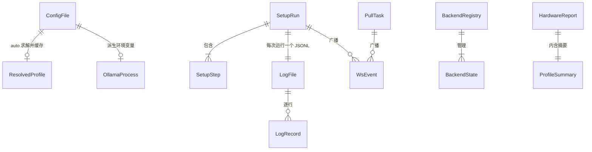

# AIE 数据模型与状态存储设计 v1.0

- 版本：v1.0-draft（待评审）
- 作者：数据建模工程师 储海量
- 读者：主理人（高屋建）、Phase 2 专项（安智体/程不宕/颜可心/陆上线/凌无缺）、实现组
- 落盘路径：`docs/design/04-data-model.md`
- 修订：v1.1-draft——对齐 `03-ollama-accel.md` 定稿（profile_id 7 家、ollama_accel env 表、request_options 契约、num_gpu 请求级语义、catalog 三条边界规则；硬探测/加速口径以该文档为准）
- 输入：`01-requirements.md`（US/A/S/D1–D6）、`02-architecture.md`（§4 配置键清单、§7 数据流转与存储概要、§11 裁决 D7–D16）；参考 Octop `config.py`（YAML + `${VAR}` + pydantic v2 配置层基因）

## 0. 存储总原则（全文约束）

| # | 原则 | 出处 | 本文落地 |
|---|---|---|---|
| P1 | **无数据库**。本地单用户工具，不引入任何 DB 引擎 | 架构 §7、D13 | 本文所有「表」均为逻辑模型；物理形态是文件（YAML/JSONL/文本） |
| P2 | 配置唯一真相源 = `~/.aife/config.yaml`（`config_version=1`），可整文件评审/迁移/回滚 | 架构 ADR-003、D13 | §2.1 schema 定稿 + §2.2 目录布局 + §5 迁移 |
| P3 | 密钥只 `${VAR}` 引用不落明文；GET /api/config 打码 | 架构 §4/§6、ADR-003 | §2.1.6、§7 |
| P4 | 模型文件由 Ollama 自管，AIE 不复制/不托管 | 架构 §7 | §2.2 明确「不在 .aife 内」；迁移单列 |
| P5 | 运行时状态内存态（runtime 单例），进程退出即重置 | 架构 §7、D13 | §2.3 全部状态对象 |
| P6 | 日志结构化 JSONL + 滚动文本，trace_id 贯穿 | 架构 §7、US6.2、A12 | §2.4 |
| P7 | 探测结论带 E0–E3 证据等级，无等级输出视为缺陷 | 需求 US2.2/S3 | §2.5 |
| P8 | 所有路径支持 `~`/`${VAR}` 展开，无绝对路径硬编码，整目录可迁移 | 架构 §6 可移植性 | §2.1.11、§2.2.4、§5.3 |
| P9 | 软删除/审计字段规则：**无持久化业务记录，故不适用**；运行态取消 = 终态（内存保留至进程退出）；配置与日志的时间戳即审计轨迹 | 储海量工作规则 | §2.3.1 显式说明取舍理由 |
| P10 | 容量估算必须标注假设前提，不编造数据量级 | 储海量工作规则 | §3.2 估算均带「假设」列 |

---

## 1. 实体与关系（概念模型）

### 1.1 实体清单

| 实体 | 说明 | 关键属性 | 物理形态 |
|---|---|---|---|
| ConfigFile | 唯一配置真相源 | config_version、各段键值、文件 mtime/sha256 | `~/.aife/config.yaml` 单文件 |
| RuntimeState | 进程级运行时状态（退出即失） | SetupRun / PullTask / BackendRegistry / OllamaManager / ConfigState | 内存（runtime 单例） |
| SetupRun | 一次 setup 流水线运行台账 | run_id、steps[]、status、时间戳、error/remedy | 内存 + 镜像落盘 `logs/setup-<run_id>.jsonl` |
| PullTask | 一次模型拉取任务 | task_id、model、status、completed/total | 内存（防重键=model） |
| BackendState | 后端注册表条目 | name、healthy、last_error、last_checked_at | 内存 |
| HardwareReport | 一次硬件探测结论快照 | devices[]、profile、source、generated_at | 内存缓存 + `aife detect --json` 输出；不持久化 |
| LogFile | 日志文件族 | 路径、轮转参数、保留策略 | `logs/aife.log`（滚动）+ `logs/setup-*.jsonl`（每次运行一文件） |
| EventStream | WS 事件总线广播流 | type、ts、payload | 内存队列（订阅者各一 asyncio.Queue） |
| ModelFile | Ollama 模型权重 | 名称/大小/量化/修改时间 | Ollama 自管（OLLAMA_MODELS），**不在 .aife 内** |

### 1.2 关系说明

| 关系 | 基数 | 说明 |
|---|---|---|
| ConfigFile → ResolvedProfile | 1 : 0..1（内存缓存） | 配置 `hardware.device=auto` 时由探测求解，结果仅缓存展示，不回写 YAML |
| ConfigFile → OllamaProcess | 1 : 0..1 | ollama 段（host/port/keep_alive/max_loaded_models/models_dir）决定子进程环境变量，env 类变更 → 重启 Ollama 落实；`num_gpu` 为**请求级 option 默认值**，不触发重启 |
| SetupRun → SetupStep | 1 : 1..7 | 阶段集合由 stage 枚举定（detect/deps/install/configure/pull/verify/start） |
| SetupRun → LogFile | 1 : 1 | 每次运行一个 `setup-<run_id>.jsonl`（run_id 即文件名主干） |
| SetupRun → WsEvent | 1 : 0..* | started/step_progress/step_done/error 事件序列 |
| PullTask → WsEvent | 1 : 0..* | pull_progress/pull_done 事件序列 |
| BackendRegistry → BackendState | 1 : 1..2 | ollama 常驻注册；openai_compat 常驻注册但 enabled=false 时健康检查判不健康 |
| LogRecord → WsEvent(log.line) | 1 : 0..1 | 投影广播：level ≥ 广播阈值才发，且只带 {level,logger,message,ts} 四字段 |

### 1.3 ER 图（Mermaid）



---

## 2. 逻辑模型

### 2.1 配置文件 config.yaml（字段级 schema 定稿）

> 覆盖范围：架构 §4 全部配置键 + D8 模型分档 + D9 安装方式 + D11 版本矩阵 + D1 `network.mirror` + `openai_compat` 段（密钥只 `${VAR}`）+ 日志段（US6.2/A12）。
> 「必填」列含义：是否必须在 YAML 中显式出现——**全部为否**，缺省即取默认值（P1 兼容规则见 §5.1）。
> 「热切换」列取值：`热生效`（reload 后立即）/ `需重启 Ollama`（重启子进程落实，aife-server 不动）/ `需重启 aife-server` / `下次运行生效` / `只读`。

#### 2.1.1 顶层

| 键路径 | 类型 | 必填 | 默认值 | 校验规则 | 热切换 | 敏感级 |
|---|---|---|---|---|---|---|
| `config_version` | int（Literal[1]） | 否 | 1 | 必须等于当前 schema 版本；缺失按 v1 处理并告警；大于当前版本拒绝加载（`CONFIG_VERSION_UNSUPPORTED`） | 只读 | 公开 |

#### 2.1.2 `hardware`（hardware.py 消费）

| 键路径 | 类型 | 必填 | 默认值 | 校验规则 | 热切换 | 敏感级 |
|---|---|---|---|---|---|---|
| `hardware.device` | enum | 否 | `auto` | ∈ [auto, cuda, rocm, vulkan, xpu, mps, npu, cpu]（Windows AMD 路径定稿为 `vulkan`，取代架构 §4 的 directml，见 03-ollama-accel.md；架构 §4 枚举待梁承宇同步）；`auto` 按 CUDA>ROCM>XPU>MPS>Vulkan>NPU>CPU 求解（ADR-002，最终优先级以 03-ollama-accel.md 为准） | 改后重新探测；剖面变化则需重启 Ollama | 公开 |
| `hardware.vram_gb` | float \| null | 否 | null | `>0` 或 `null`；**探测回填的只读展示位**，PATCH /api/config 写入返回 400 `CONFIG_READONLY` | 只读 | 公开 |

#### 2.1.3 `ollama`（ollama/manager.py 消费）

| 键路径 | 类型 | 必填 | 默认值 | 校验规则 | 热切换 | 敏感级 |
|---|---|---|---|---|---|---|
| `ollama.host` | str | 否 | `127.0.0.1` | IPv4/IPv6/主机名；注入 `OLLAMA_HOST` | 需重启 Ollama | 公开 |
| `ollama.port` | int | 否 | 11434 | 1–65535；**不可等于 `server.port`**（model_validator 跨字段校验） | 需重启 Ollama | 公开 |
| `ollama.autostart` | bool | 否 | true | — | 热生效（影响下次拉起决策） | 公开 |
| `ollama.keep_alive` | str | 否 | `5m` | 时长串 `^[0-9]+(s\|m\|h\|d)$`（Nd/Nh/Nm/Ns 口径） | 需重启 Ollama | 公开 |
| `ollama.num_gpu` | int | 否 | -1 | `≥ -1`；**请求级 option 默认值**（`/api/chat` body `options.num_gpu`，Ollama 无 env/启动参数形态）：GPU 剖面 -1（自动分层卸载）/ cpu 剖面 0（显式不卸载，确定性信号）/ apple_mps 不设（D12，Ollama 自管统一内存）；`OLLAMA_NUM_GPU` 不存在于官方文档，**黑名单禁注入**（03-ollama-accel.md §2.2） | 热生效（下个请求携带，**不触发 Ollama 重启**） | 公开 |
| `ollama.max_loaded_models` | int | 否 | 1 | 1–8（按内存约束，架构 §4） | 需重启 Ollama | 公开 |
| `ollama.executable` | str | 否 | `ollama` | 可执行文件名或路径（便携/绿色安装场景）；加载时 `expanduser/expandvars` | 下次拉起生效 | 公开 |
| `ollama.models_dir` | str \| null | 否 | null | `null`=Ollama 默认（`~/.ollama/models`）；非 null 注入 `OLLAMA_MODELS`，支持 `~`/`${VAR}` | 需重启 Ollama | 公开 |
| `ollama.min_version` | str | 否 | `0.5.0` | 语义化版本 `^\d+\.\d+\.\d+$`；**D11 版本矩阵下限**，doctor 对低于它的版本报不支持并给升级命令 | 热生效（doctor 下次检查） | 公开 |
| `ollama.install.method` | enum | 否 | `auto` | ∈ [auto, winget, brew, apt, script, manual]；**D9 安装方式优先级**：auto = Windows→winget（无则官方 .exe 指引）/ macOS→brew（无则 .dmg）/ Linux→官方 install.sh（apt 存在时提示不在官方源的现实） | 下次 setup 生效 | 公开 |
| `ollama.install.confirm` | bool | 否 | true | 下载/安装前询问（继承 Octop「不静默下载」基因）；`setup --yes` 或非交互模式可绕过 | 下次 setup 生效 | 公开 |

> **Ollama 子进程 env 全景**（剖面 env 表 + 全局叠加 + 条件派生，定稿口径见 §2.5.2 与 03-ollama-accel.md）：全局叠加 `OLLAMA_HOST`（由 host:port 生成，默认 127.0.0.1:11434，D10）、`OLLAMA_KEEP_ALIVE`（默认 5m）、`OLLAMA_MAX_LOADED_MODELS=1`（**显式设 1**——官方多来源对该默认值表述不一，显式消除版本差异）；条件派生 `OLLAMA_TMPDIR`（models_dir 与系统临时目录不同分区且临时分区空间小时）、`HTTP_PROXY/HTTPS_PROXY/NO_PROXY`（配了 network.proxy 时注入，NO_PROXY 必须含 127.0.0.1,localhost）。env 集合变化 = 需重启 Ollama；`num_gpu` 不走 env。

#### 2.1.4 `models`（models/catalog.py、models/manager.py 消费）+ D8 分档表

| 键路径 | 类型 | 必填 | 默认值 | 校验规则 | 热切换 | 敏感级 |
|---|---|---|---|---|---|---|
| `models.default` | str \| null | 否 | null | `null`=按剖面推荐；非 null 须匹配模型名格式 `^[a-z0-9._-]+(/[a-z0-9._-]+)?(:[a-z0-9._-]+)?$`（如 `qwen2.5:3b`） | 热生效（下次推理请求） | 公开 |
| `models.tier` | enum | 否 | `auto` | ∈ [auto, 1.5b, 3b, 7b, 14b]；锁定推荐档位，`auto`=按剖面走 D8 分档表 | 热生效（下次推荐） | 公开 |
| `models.max_concurrent_pull` | int | 否 | 1 | 1–4 | 热生效（下次拉取） | 公开 |

**D8 模型分档表（catalog 内置数据契约，`models.tier=auto` 时求值；由安智体在 catalog 专项定稿，此处定数据结构与优先级）**：

| tier | 默认模型 | 适用条件（优先级从高到低求值） | 近似体积（假设 Q4_K_M） | 备注 |
|---|---|---|---|---|
| 1.5b | `qwen2.5:1.5b` | RAM < 8GB | ~1.0GB | 低端办公机兜底档 |
| 3b | `qwen2.5:3b` | 8GB ≤ RAM < 16GB（无独显） | ~1.9GB | CPU 路径默认档（D4/D8） |
| 7b | `qwen2.5:7b` | 16GB ≤ RAM < 32GB；或 8GB ≤ GPU VRAM < 12GB | ~4.4GB | GPU 中档 |
| 14b | `qwen2.5:14b` | RAM ≥ 32GB；或 GPU VRAM ≥ 12GB | ~8.7GB | 高档 |
| — | Apple Silicon | 统一内存按总 RAM 走上表（D12）；Metal 后端不设 num_gpu，catalog 标注 unified memory 语义 | — | Metal 由 Ollama 自管 |

求值规则（安智体确认 + 三条边界补充）：**有独显 VRAM 时按 VRAM 行求值，否则按 RAM 行求值；`models.default` 非 null 时全表覆盖；`models.tier` 非 auto 时锁定该档**。边界规则：① Apple 统一内存走 RAM 行（D12：统一内存=总 RAM，无独立 VRAM 概念）；② NPU/无加速走 CPU 行（RAM 行）；③ 实验路径（vulkan/intel_xpu）先按独显 VRAM 行求值，**探针验证失败回退 CPU 后按 RAM 行重求档位**——因此 `catalog.recommend` 接收「当前生效 device」而非「探测到的 device」，天然覆盖重求语义。tier→Ollama tag 映射在代码里单一来源（一张表或一个函数），避免 YAML 键与 tag 两处硬编码。体积列为假设值（Q4_K_M 量级），实现以 `ollama show` 实测为准；磁盘预检按「模型体积×1.5+2GB 临时空间」（R-19，见 §9）。

#### 2.1.5 `backends`（backends/registry 消费）

| 键路径 | 类型 | 必填 | 默认值 | 校验规则 | 热切换 | 敏感级 |
|---|---|---|---|---|---|---|
| `backends.active` | enum | 否 | `ollama` | ∈ [ollama, openai_compat]；openai_compat 未 enabled 时激活返回 503 `BACKEND_UNHEALTHY`（force 豁免） | 热生效（广播 backend.changed） | 公开 |
| `backends.fallback` | list[enum] | 否 | `[ollama]` | 非空；元素 ∈ [ollama, openai_compat]；回退原因进 last_errors 可展示（继承 Octop 基因） | 热生效 | 公开 |

#### 2.1.6 `openai_compat`（US5.4，Should；backends/openai_compat.py 消费）

| 键路径 | 类型 | 必填 | 默认值 | 校验规则 | 热切换 | 敏感级 |
|---|---|---|---|---|---|---|
| `openai_compat.enabled` | bool | 否 | false | false 时该后端注册但不健康（缺配置） | 热生效 | 公开 |
| `openai_compat.base_url` | str | 否 | `${AIE_OPENAI_BASE_URL:-https://api.openai.com/v1}` | 展开后须为 http(s) URL | 热生效 | 公开 |
| `openai_compat.api_key` | str | 否 | `${AIE_OPENAI_API_KEY:-}` | **敏感（secret）**：只允许空串或 `${VAR}` / `${VAR:-default}` 形式（field_validator 正则 `^\$\{[A-Za-z_][A-Za-z0-9_]*(:-[^}]*)?\}$`），明文写入被 400 `CONFIG_INVALID` 拒绝；GET /api/config 恒显示 `"***"` | 热生效（每请求读取） | **敏感** |
| `openai_compat.model` | str | 否 | `gpt-4o-mini` | 非空 | 热生效 | 公开 |
| `openai_compat.timeout_s` | float | 否 | 120 | `>0` | 热生效 | 公开 |
| `openai_compat.max_retries` | int | 否 | 2 | 0–5 | 热生效 | 公开 |

#### 2.1.7 `server`（server/app.py 消费）

| 键路径 | 类型 | 必填 | 默认值 | 校验规则 | 热切换 | 敏感级 |
|---|---|---|---|---|---|---|
| `server.host` | str | 否 | `127.0.0.1` | IP 或主机名；D10：MVP 默认仅本地，改 `0.0.0.0` 时 README/doctor 明示风险 | 需重启 aife-server | 公开 |
| `server.port` | int | 否 | 8189 | 1–65535（D5）；**不可等于 `ollama.port`** | 需重启 aife-server | 公开 |
| `server.log_level` | enum | 否 | `info` | ∈ [debug, info, warning, error] | 热生效 | 公开 |
| `server.open_browser` | bool | 否 | true | — | 下次 serve 生效 | 公开 |

#### 2.1.8 `network`（D1 多镜像回退 + 代理；bootstrap/ollama 下载与模型拉取共用）

| 键路径 | 类型 | 必填 | 默认值 | 校验规则 | 热切换 | 敏感级 |
|---|---|---|---|---|---|---|
| `network.mirror` | enum | 否 | `auto` | ∈ [auto, official, custom]；`auto`=官方源优先、失败按内置镜像清单回退**并明确告知用户走了哪条路**（D1，不静默改流量走向） | 热生效 | 公开 |
| `network.mirror_urls` | list[str] | 否 | `[]` | `mirror=custom` 时非空；元素为 http(s) URL；`auto` 模式下作为用户追加的自定义回退项 | 热生效 | 公开 |
| `network.proxy` | str \| null | 否 | null | `null`=读 `HTTP_PROXY`/`HTTPS_PROXY` 环境变量；非 null 为 http(s) URL | 热生效 | **条件敏感**（URL 内嵌 user:pass 时掩码） |
| `network.connect_timeout_s` | float | 否 | 10 | `>0` | 热生效 | 公开 |
| `network.read_timeout_s` | float | 否 | 600 | `>0`；模型分块下载需要长读超时（S1 国内网络口径） | 热生效 | 公开 |
| `network.retries` | int | 否 | 2 | 0–5 | 热生效 | 公开 |

#### 2.1.9 `setup` / `bench` / `logging`

| 键路径 | 类型 | 必填 | 默认值 | 校验规则 | 热切换 | 敏感级 |
|---|---|---|---|---|---|---|
| `setup.skip` | list[enum] | 否 | `[]` | 元素 ∈ [deps, ollama, model]；断点续跑（US1.2），已完成阶段不重复执行 | 下次 setup 生效 | 公开 |
| `bench.duration_s` | int | 否 | 30 | `>0` | 下次 bench 生效 | 公开 |
| `logging.dir` | str \| null | 否 | null | `null`=派生自配置文件同级 `logs/`；非 null 支持 `~`/`${VAR}`（整目录迁移时日志跟随配置） | 下次运行生效 | 公开 |
| `logging.app_file` | str | 否 | `aife.log` | 纯文件名，不含路径分隔符 | 下次运行生效 | 公开 |
| `logging.rotate_max_mb` | float | 否 | 10 | `>0`；RotatingFileHandler maxBytes | 下次轮转生效 | 公开 |
| `logging.rotate_backups` | int | 否 | 5 | `≥0`；备份文件数（10MB×5，架构 §7） | 下次轮转生效 | 公开 |
| `logging.run_log_keep` | int | 否 | 20 | `≥1`；`setup-*.jsonl` 保留最近 N 个运行文件 | 下次运行生效 | 公开 |
| `logging.jsonl` | bool | 否 | true | setup 运行日志用 JSONL（US6.2/A12） | 下次运行生效 | 公开 |
| `logging.console_level` | enum | 否 | `info` | ∈ [debug, info, warning, error] | 下次运行生效 | 公开 |

#### 2.1.10 跨字段校验（model_validator，加载与 PATCH 均执行）

1. `server.port != ollama.port`（端口冲突 400 `CONFIG_INVALID`）。
2. `network.mirror == "custom"` 时 `network.mirror_urls` 非空。
3. `backends.fallback` 非空且元素 ∈ 已注册后端名。
4. `openai_compat.api_key` 只允许 `${VAR}` 形式或空串（见 2.1.6）。
5. 未知顶层键：`extra="ignore"` + warning 日志（前向兼容：新版本写的配置旧版本可读，规则见 §5.1 R5）。

#### 2.1.11 pydantic v2 映射要点（可直接落 `aife/config.py`）

```python
# 顶层：extra="ignore" 实现前向兼容；mtime+sha256 双检实现 reload 变更检测
class AifeConfig(BaseModel):
    model_config = ConfigDict(extra="ignore")
    config_version: Literal[1] = 1
    hardware: HardwareConfig = Field(default_factory=HardwareConfig)
    ollama: OllamaConfig = Field(default_factory=OllamaConfig)
    models: ModelsConfig = Field(default_factory=ModelsConfig)
    backends: BackendsConfig = Field(default_factory=BackendsConfig)
    openai_compat: OpenAICompatConfig = Field(default_factory=OpenAICompatConfig)
    server: ServerConfig = Field(default_factory=ServerConfig)
    network: NetworkConfig = Field(default_factory=NetworkConfig)
    setup: SetupConfig = Field(default_factory=SetupConfig)
    bench: BenchConfig = Field(default_factory=BenchConfig)
    logging: LoggingConfig = Field(default_factory=LoggingConfig)

class HardwareConfig(BaseModel):
    device: Literal["auto","cuda","rocm","xpu","mps","directml","npu","cpu"] = "auto"
    vram_gb: Optional[Annotated[float, Field(gt=0)]] = None   # 只读展示位

class OllamaConfig(BaseModel):
    host: str = "127.0.0.1"                                   # field_validator: IP/主机名
    port: Annotated[int, Field(ge=1, le=65535)] = 11434
    autostart: bool = True
    keep_alive: str = "5m"                                    # field_validator: ^[0-9]+(s|m|h|d)$
    num_gpu: Annotated[int, Field(ge=-1)] = -1
    max_loaded_models: Annotated[int, Field(ge=1, le=8)] = 1
    executable: str = "ollama"                                # mode="before": expanduser/expandvars
    models_dir: Optional[str] = None                          # mode="before": expanduser/expandvars
    min_version: str = "0.5.0"                                # field_validator: ^\d+\.\d+\.\d+$
    install: InstallConfig = Field(default_factory=InstallConfig)

class InstallConfig(BaseModel):
    method: Literal["auto","winget","brew","apt","script","manual"] = "auto"
    confirm: bool = True

class ModelsConfig(BaseModel):
    default: Optional[str] = None                             # field_validator: 模型名格式
    tier: Literal["auto","1.5b","3b","7b","14b"] = "auto"
    max_concurrent_pull: Annotated[int, Field(ge=1, le=4)] = 1

class BackendsConfig(BaseModel):
    active: Literal["ollama","openai_compat"] = "ollama"
    fallback: Annotated[list[Literal["ollama","openai_compat"]], Field(min_length=1)] = ["ollama"]

class OpenAICompatConfig(BaseModel):
    enabled: bool = False
    base_url: str = "${AIE_OPENAI_BASE_URL:-https://api.openai.com/v1}"
    api_key: str = "${AIE_OPENAI_API_KEY:-}"                  # field_validator: 空或 ^\$\{...\}$
    model: str = "gpt-4o-mini"
    timeout_s: Annotated[float, Field(gt=0)] = 120
    max_retries: Annotated[int, Field(ge=0, le=5)] = 2

class ServerConfig(BaseModel):
    host: str = "127.0.0.1"
    port: Annotated[int, Field(ge=1, le=65535)] = 8189
    log_level: Literal["debug","info","warning","error"] = "info"
    open_browser: bool = True

class NetworkConfig(BaseModel):
    mirror: Literal["auto","official","custom"] = "auto"
    mirror_urls: list[str] = []
    proxy: Optional[str] = None
    connect_timeout_s: Annotated[float, Field(gt=0)] = 10
    read_timeout_s: Annotated[float, Field(gt=0)] = 600
    retries: Annotated[int, Field(ge=0, le=5)] = 2

class SetupConfig(BaseModel):
    skip: list[Literal["deps","ollama","model"]] = []

class BenchConfig(BaseModel):
    duration_s: Annotated[int, Field(gt=0)] = 30

class LoggingConfig(BaseModel):
    dir: Optional[str] = None                                 # mode="before": expanduser/expandvars
    app_file: str = "aife.log"
    rotate_max_mb: Annotated[float, Field(gt=0)] = 10
    rotate_backups: Annotated[int, Field(ge=0)] = 5
    run_log_keep: Annotated[int, Field(ge=1)] = 20
    jsonl: bool = True
    console_level: Literal["debug","info","warning","error"] = "info"

# 跨字段校验（2.1.10 的 1/2 在此实现）
@model_validator(mode="after")
def _check_cross(self) -> "AifeConfig":
    if self.server.port == self.ollama.port:
        raise ValueError("server.port 不可与 ollama.port 相同")
    if self.network.mirror == "custom" and not self.network.mirror_urls:
        raise ValueError("mirror=custom 时 network.mirror_urls 不可为空")
    return self
```

> 加载管线（继承 Octop）：`yaml.safe_load` → `expand_env`（递归展开 `${VAR}` / `${VAR:-default}`）→ `model_validate` → 版本迁移（§5）→ 校验失败即拒绝并**保留旧配置**（ADR-003 后果条）。
> 不用 `SecretStr`：密钥需经 `${VAR}` 展开且掩码策略由视图层统一控制（§7.2），`str` + 正则 validator + ConfigView 打码更直接。

#### 2.1.12 完整模板文件 `config/aife.yaml`（仓库模板，D13：setup 首跑复制到 `~/.aife/`）

```yaml
# =============================================================================
# AIE（AI For Everyone）配置文件 —— 唯一配置真相源
# 位置：~/.aife/config.yaml（D13 用户级）；本文件为仓库模板，setup 首次运行复制
# 规则：
#   1. 密钥只写 ${VAR} 引用（如 ${AIE_OPENAI_API_KEY:-}），禁止明文；
#   2. 路径支持 ~ 与 ${VAR} 展开；不写绝对路径，保证 ~/.aife 整目录可迁移；
#   3. config_version 为 schema 版本号，演进规则见 docs/design/04-data-model.md §5；
#   4. 所有字段均可缺省，缺省值即本文件所示默认值。
# =============================================================================
config_version: 1

# ---- 硬件剖面（hardware.py 消费） --------------------------------------------
hardware:
  device: auto              # auto 按 CUDA>ROCM>XPU>MPS>DirectML>NPU>CPU 求解（ADR-002）
  vram_gb: null             # 只读展示位：探测回填；PATCH /api/config 拒绝写入

# ---- Ollama 进程（ollama/manager.py 消费） -----------------------------------
ollama:
  host: 127.0.0.1           # 注入 OLLAMA_HOST；修改后需重启 Ollama 子进程
  port: 11434               # 1-65535；不可与 server.port 相同
  autostart: true           # aife serve/setup 时自动拉起 Ollama
  keep_alive: 5m            # 模型驻留时长；格式 ^[0-9]+(s|m|h|d)$
  num_gpu: -1               # -1=自动分层卸载；0=纯 CPU；>0=层数
  max_loaded_models: 1      # 1-8，按内存约束
  executable: ollama        # 可执行文件名或路径；便携/绿色安装场景使用
  models_dir: null          # 注入 OLLAMA_MODELS；null=Ollama 默认（~/.ollama/models）
  min_version: 0.5.0        # D11 版本矩阵下限；doctor 对低于此版本报不支持
  install:                  # D9 安装方式优先级
    method: auto            # auto|winget|brew|apt|script|manual
    confirm: true           # 下载/安装前询问（--yes 可绕过）

# ---- 模型（models/catalog.py、models/manager.py 消费） -----------------------
models:
  default: null             # null=按剖面推荐（D8 分档表）；非 null=显式模型名
  tier: auto                # auto|1.5b|3b|7b|14b；锁定推荐档位
  # D8 分档表（catalog 内置，仅文档说明，不在 YAML 维护）：
  #   RAM<8GB → qwen2.5:1.5b｜8-16GB → qwen2.5:3b｜16-32GB → qwen2.5:7b
  #   GPU VRAM 8-12GB → qwen2.5:7b｜≥12GB → qwen2.5:14b｜Apple 统一内存按总 RAM
  max_concurrent_pull: 1    # 1-4

# ---- 推理后端（backends/registry 消费） --------------------------------------
backends:
  active: ollama            # ollama|openai_compat；热切换不重启服务
  fallback: [ollama]        # 非空；元素 ∈ [ollama, openai_compat]

# ---- 外部 OpenAI 兼容后端（US5.4 Should；本地故障时回退） ---------------------
openai_compat:
  enabled: false
  base_url: ${AIE_OPENAI_BASE_URL:-https://api.openai.com/v1}
  api_key: ${AIE_OPENAI_API_KEY:-}        # 敏感：只允许 ${VAR} 形式；GET /api/config 打码
  model: gpt-4o-mini
  timeout_s: 120
  max_retries: 2

# ---- aife-server（server/app.py 消费） ---------------------------------------
server:
  host: 127.0.0.1           # D10：MVP 默认仅本地；改 0.0.0.0 需自知风险（README 明示）
  port: 8189                # D5；不可与 ollama.port 相同
  log_level: info           # debug|info|warning|error
  open_browser: true        # serve 后自动打开浏览器

# ---- 网络（D1：多镜像回退 + 显式配置点，不静默改流量走向） -------------------
network:
  mirror: auto              # auto=官方源优先、失败按内置镜像清单回退并告知；official=仅官方；custom=仅 mirror_urls
  mirror_urls: []           # custom 模式的镜像/代理基址列表（http(s)://）
  proxy: null               # http(s)://...；null=读 HTTP_PROXY/HTTPS_PROXY 环境变量
  connect_timeout_s: 10
  read_timeout_s: 600       # 大模型分块下载需要长读超时
  retries: 2

# ---- setup 流水线（bootstrap.py 消费） ---------------------------------------
setup:
  skip: []                  # 元素 ∈ [deps,ollama,model]；断点续跑（US1.2）

# ---- bench --------------------------------------------------------------------
bench:
  duration_s: 30            # >0

# ---- 日志（utils/logging.py 消费） -------------------------------------------
logging:
  dir: null                 # null=配置文件同级 logs/；非 null=显式目录（迁移时日志跟随配置）
  app_file: aife.log        # 滚动应用日志：10MB×5（架构 §7）
  rotate_max_mb: 10
  rotate_backups: 5
  run_log_keep: 20          # setup-*.jsonl 保留最近 N 个运行文件
  jsonl: true               # setup 运行日志用 JSONL（US6.2/A12）
  console_level: info
```

### 2.2 `~/.aife` 目录布局规范（D13）

#### 2.2.1 布局

```
~/.aife/                              # 用户级运行时根（跨会话持久，可整目录迁移）
├── config.yaml                       # 唯一配置真相源（schema 见 §2.1）
├── config.yaml.bak                   # 迁移/自动修复前的最近一次备份（单文件滚动）
├── .setup.lock                       # 跨进程 setup 互斥锁（O_CREAT|O_EXCL；pid+ts，僵死检测）
└── logs/
    ├── aife.log                      # 滚动应用日志（所有命令共用，文本/JSONL 行）
    ├── aife.log.1 … aife.log.5       # RotatingFileHandler 备份（10MB×5）
    ├── setup-<run_id>.jsonl          # 每次 setup 运行一个文件（US6.2/A12）
    └── doctor-<ts>.jsonl             # 【演进候选，不在 MVP】doctor 运行留痕
```

**明确不在 `~/.aife` 内的东西**（P4/P5）：模型权重（Ollama 自管 `OLLAMA_MODELS`）、运行时状态（内存态，不落盘）、业务数据（无数据库）、遥测（D16 不实现）。

#### 2.2.2 每个文件的生命周期与清理策略

| 路径 | 创建时机 | 写入方 | 生命周期 | 清理策略 |
|---|---|---|---|---|
| `config.yaml` | setup/serve 首跑（模板复制或内置默认生成） | config.py（PATCH/migration/原子重写） | 长期 | 不自动清理；用户可删（删后下次运行重建默认） |
| `config.yaml.bak` | 任何迁移/自动修复写盘前 | config.py | 单文件滚动 | 每次覆盖，只保留最近 1 份 |
| `.setup.lock` | setup 启动 | bootstrap.py | 运行期 | 正常退出删除；僵死（pid 不存在或 age>6h）下轮启动强制破除 |
| `logs/aife.log*` | 任何命令首次写日志 | utils/logging.py | 滚动 | 10MB 轮转、保留 5 份；超龄由轮转自然淘汰 |
| `logs/setup-<run_id>.jsonl` | 每次 setup 运行开始 | bootstrap.py + utils/logging.py | 运行期 + 保留期 | 启动时按 `logging.run_log_keep`（默认 20）删旧；best-effort，失败仅告警 |

`run_id` 格式：`setup-<YYYYMMDD-HHMMSS>-<rand6>`（本地时区，例 `setup-20250601-142305-9f3ac1`）；文件名 = `run_id + ".jsonl"`，与内存 SetupRun.run_id 一一对应（§2.3.1）。

#### 2.2.3 容量估算（均带假设，不编造）

| 对象 | 估算 | 假设前提 |
|---|---|---|
| `config.yaml` | 4–6 KB | 模板全文量级 |
| `aife.log*` | ≤ 60 MB | 10MB×6（active+5 备份）上限 |
| `setup-*.jsonl` | 90–500 KB/run；20 runs ≈ 2–10 MB | 假设单次 setup 600–2000 条记录 × 150–250 B/条 |
| `~/.aife` 稳态合计 | **≤ ~70 MB**（不含模型） | 上述各项叠加 |
| 模型文件 | 不入估算 | Ollama 自管；3B Q4_K_M 约 1.9GB 为量级参考 |

#### 2.2.4 整目录迁移方式（P8）

前提：① 配置内无绝对路径硬编码（全部相对/`~`/`${VAR}`——由 §2.1 validator 保证）；② `ollama.models_dir` 若曾设为绝对路径，需在新机重建该目录或改配置；③ 源/目标机 aife 进程均已停止；④ 模型文件不在 `.aife` 内，需单独迁移 `OLLAMA_MODELS` 目录。

步骤：
1. 旧机 `aife doctor` 确认全绿（迁出前基线）。
2. 停止旧机 `aife serve`（Ctrl-C 优雅退出）。
3. 整目录拷贝 `~/.aife/` → 新机 `~/.aife/`（保留 `config.yaml`、`logs/`；`.setup.lock` 建议删除）。
4. 新机设 `AIE_CONFIG=~/.aife/config.yaml`（或放默认位）执行 `aife doctor`：验证配置加载、剖面求解、Ollama 连通、模型列表。
5. 若第 ④ 条涉及绝对路径，`PATCH /api/config` 或直接编辑 `ollama.models_dir` 修正后复跑 doctor。
6. 模型目录迁移后执行 `aife models list` + 推理探针对账（US4.3 口径）。

验收观测点：迁移后 `aife doctor` 五类检查全 OK；`aife detect --json` 剖面与新机硬件一致；日志目录可继续追加写。

### 2.3 运行时状态数据模型（内存态，P5）

> 全部定义在 `aife/runtime.py` 单例内；进程退出即重置，不持久化。软删除不适用（无持久业务记录，P9）；`CANCELLED` 为终态，任务记录保留至进程退出供 `GET /api/setup/status` 查询。

#### 2.3.1 SetupRun / SetupStep（bootstrap.py）

```python
class SetupStage(str, Enum):          # 需求 US1.1 六阶段 + deps 前置检查（US1.3）
    DETECT = "detect"; DEPS = "deps"; INSTALL = "install"; CONFIGURE = "configure"
    PULL = "pull"; VERIFY = "verify"; START = "start"

class StepStatus(str, Enum):
    PENDING = "pending"; RUNNING = "running"; DONE = "done"; FAILED = "failed"; SKIPPED = "skipped"

class RunStatus(str, Enum):
    PENDING = "pending"; RUNNING = "running"; SUCCEEDED = "succeeded"; FAILED = "failed"; CANCELLED = "cancelled"

class ErrorDetail(BaseModel):         # 与架构 §5.1 错误体同构
    code: str                         # DOMAIN_REASON，如 OLLAMA_UNAVAILABLE / MODEL_CORRUPTED
    message: str
    remedy: Optional[str] = None      # 可执行修复指引（US6.3：可直接复制执行的命令）
    trace_id: Optional[str] = None

class SetupStep(BaseModel):
    name: SetupStage
    status: StepStatus = StepStatus.PENDING
    started_at: Optional[datetime] = None
    finished_at: Optional[datetime] = None
    duration_ms: Optional[int] = None          # finished-started，毫秒
    progress_message: Optional[str] = None     # 最近一次 step_progress 文案
    error: Optional[ErrorDetail] = None

class SetupRun(BaseModel):
    run_id: str                                # setup-<YYYYMMDD-HHMMSS>-<rand6>，同日志文件名
    status: RunStatus = RunStatus.PENDING
    trigger: Literal["cli", "api"] = "cli"
    steps: list[SetupStep]                     # 固定 7 项，按枚举序；skip 的阶段置 SKIPPED
    skip: list[str] = []                       # ∈ [deps,ollama,model]
    current_step: Optional[SetupStage] = None
    created_at: datetime
    updated_at: datetime
    finished_at: Optional[datetime] = None
    error: Optional[ErrorDetail] = None
```

约束：同一进程内同时仅 1 个 RUNNING SetupRun（API 侧重复触发返回 409 `SETUP_RUNNING`；CLI 侧靠 `.setup.lock` 跨进程互斥）。

#### 2.3.2 PullTask（models/manager.py）

```python
class PullStatus(str, Enum):
    PENDING = "pending"; RUNNING = "running"; DONE = "done"; FAILED = "failed"; CANCELLED = "cancelled"

class PullTask(BaseModel):
    task_id: str                               # pull-<uuid4hex[:12]>
    model: str                                 # 防重键（dedupe_key == model）
    status: PullStatus = PullStatus.PENDING
    completed: int = 0                         # 已下载字节（Ollama /api/pull completed）
    total: Optional[int] = None                # 总字节；Ollama 首帧可能为 0/缺失
    percent: Optional[float] = None            # 派生字段：completed/total*100，total 为 0/None 时为空
    started_at: datetime
    updated_at: datetime
    finished_at: Optional[datetime] = None
    error: Optional[ErrorDetail] = None
```

防重规则：同 `model` 已有 PENDING/RUNNING 任务 → 返回既有 task_id 并抛 409 `PULL_IN_PROGRESS`（链路 C）；`max_concurrent_pull` 控制并发上限。

#### 2.3.3 BackendRegistry 状态（backends/__init__.py）

```python
class BackendState(BaseModel):
    name: Literal["ollama", "openai_compat"]
    kind: Literal["ollama", "openai_compat"]
    healthy: bool = False
    detail: str = ""                           # 不健康原因，如 "missing model qwen2.5:3b"
    last_error: Optional[ErrorDetail] = None   # 继承 Octop last_errors：回退原因可展示（US5.4）
    last_checked_at: Optional[datetime] = None

class RegistrySnapshot(BaseModel):             # GET /api/backends 响应体（pydantic，ADR-006）
    active: str
    chain: list[str]                           # fallback 链
    backends: dict[str, BackendState]
    last_switch: Optional[BackendSwitch] = None

class BackendSwitch(BaseModel):                # backend.changed 事件 payload
    frm: str                                   # 原后端（from 是关键字，用 frm）
    to: str
    reason: str
    ts: datetime
```

规则：`ollama` 健康 = Ollama 可达 **且默认模型已安装**（缺模型判不健康，继承 Octop M14 教训）；`openai_compat` 健康 = `enabled=true` 且 `api_key` 展开非空且 base_url 可达。

#### 2.3.4 OllamaManager 状态（ollama/manager.py）

```python
class OllamaStatus(str, Enum):
    STOPPED = "stopped"; STARTING = "starting"; RUNNING = "running"
    UNHEALTHY = "unhealthy"; CRASHED = "crashed"

class OllamaManagerState(BaseModel):
    status: OllamaStatus = OllamaStatus.STOPPED
    pid: Optional[int] = None
    version: Optional[str] = None              # /api/version；低于 min_version 时 UNHEALTHY
    env: dict[str, str] = Field(default_factory=dict)   # 注入的环境变量；值脱敏后入日志
    restart_count: int = 0                     # 崩溃自动拉起计数（退避 3 次，架构 §6）
    started_at: Optional[datetime] = None
    last_error: Optional[ErrorDetail] = None
```

派生 env 变更检测：reload 时比对「按新配置派生的 env」与 `env`，不同则重启 Ollama 子进程并广播 `health.changed`（架构 §10.2 风险对策）。

#### 2.3.5 事件总线（server/ws.py）

```python
class WsEvent(BaseModel):                      # 架构 §5.3 信封统一
    type: str                                  # 事件字典（见 §5.3 表）
    ts: datetime
    payload: dict[str, Any] = Field(default_factory=dict)

class EventBus:
    subscribers: set[asyncio.Queue[WsEvent]]   # 每订阅者一个队列
    queue_maxsize: int = 256                   # 背压策略：满则丢最旧 + warning 日志（不阻塞发布方）
    heartbeat_s: float = 30.0                  # 心跳事件 heartbeat {}
    def publish(self, event: WsEvent) -> None: ...     # 非阻塞 put_nowait，逐订阅者 try/except
    def subscribe(self) -> asyncio.Queue[WsEvent]: ...
    def unsubscribe(self, q) -> None: ...
```

`log.line` 是 LogRecord 的投影（§2.4.4），不是独立数据源。

### 2.4 JSONL 结构化日志 schema（US6.2 / A12）

#### 2.4.1 字段表（每行一个 JSON 对象，UTF-8，LF 换行）

| 字段 | 类型 | 必填 | 说明 |
|---|---|---|---|
| `ts` | str(ISO8601, UTC, 毫秒) | 是 | 如 `2025-06-01T14:23:05.123Z` |
| `level` | enum | 是 | DEBUG/INFO/WARNING/ERROR（CRITICAL 不使用） |
| `logger` | str | 是 | 点分模块名，如 `aife.bootstrap` / `aife.ollama.manager` |
| `stage` | str \| null | 否 | setup 运行 = SetupStage 枚举值；其他命令 = `serve`/`doctor`/`models`/`chat`/`system`/`config` 等；无阶段为空 |
| `run_id` | str \| null | 否 | setup 运行 id（同文件名）；非 setup 为空 |
| `trace_id` | str \| null | 否 | 关联 id：setup 运行 = run_id；HTTP 请求 = 每请求 uuid（响应头 `X-Trace-Id` 与错误体一致） |
| `duration_ms` | int \| null | 否 | 步骤/请求耗时；运行起止记录为总时长 |
| `message` | str | 是 | 人类可读文案 |
| `event` | str \| null | 否 | `run_start`/`run_end`/`step_start`/`step_done`/`progress`/`log`（默认 `log`） |
| `extra` | object | 否 | 结构化明细；**禁密**：键名匹配 `(?i)(key\|token\|secret\|password\|credential)` 的值写日志前替换为 `"***"`（§7.3） |

#### 2.4.2 setup 六阶段 stage 枚举（含 deps 前置）

需求 US1.1 口径的六阶段 = `detect / install / configure / pull / verify / start`；`deps` 为 US1.3 前置检查阶段（RAM/磁盘/Python 版本），日志中独立枚举值。完整枚举见 §2.3.1 `SetupStage`（7 值）。阶段时间戳差即需求 §6「阶段耗时分解」指标的数据来源。

#### 2.4.3 运行起止记录范例（`logs/setup-20250601-142305-9f3ac1.jsonl`）

```json
{"ts":"2025-06-01T14:23:05.123Z","level":"INFO","logger":"aife.bootstrap","stage":"deps","run_id":"setup-20250601-142305-9f3ac1","trace_id":"setup-20250601-142305-9f3ac1","duration_ms":null,"message":"run started","event":"run_start","extra":{"skip":[],"planned_stages":["deps","detect","install","configure","pull","verify","start"]}}
{"ts":"2025-06-01T14:23:07.880Z","level":"INFO","logger":"aife.bootstrap","stage":"deps","run_id":"setup-20250601-142305-9f3ac1","trace_id":"setup-20250601-142305-9f3ac1","duration_ms":2757,"message":"step done: deps","event":"step_done","extra":{"status":"done"}}
{"ts":"2025-06-01T14:31:48.002Z","level":"INFO","logger":"aife.bootstrap","stage":"pull","run_id":"setup-20250601-142305-9f3ac1","trace_id":"setup-20250601-142305-9f3ac1","duration_ms":412300,"message":"step done: pull","event":"step_done","extra":{"status":"done","model":"qwen2.5:3b","bytes":1938616883}}
{"ts":"2025-06-01T14:32:01.510Z","level":"ERROR","logger":"aife.bootstrap","stage":"verify","run_id":"setup-20250601-142305-9f3ac1","trace_id":"setup-20250601-142305-9f3ac1","duration_ms":null,"message":"step failed: verify","event":"step_done","extra":{"status":"failed","code":"MODEL_CORRUPTED","remedy":"ollama rm qwen2.5:3b && aife models pull qwen2.5:3b"}}
{"ts":"2025-06-01T14:32:01.512Z","level":"ERROR","logger":"aife.bootstrap","stage":"verify","run_id":"setup-20250601-142305-9f3ac1","trace_id":"setup-20250601-142305-9f3ac1","duration_ms":536389,"message":"run finished","event":"run_end","extra":{"status":"failed"}}
```

A12 观测点：`grep -c '"event":"run_start"' ~/.aife/logs/setup-*.jsonl` = 运行次数；起止记录均含 `duration_ms` 与 `stage`。

#### 2.4.4 滚动策略与 WS `log.line` 的关系

- **`aife.log`（文本/JSONL 行混写用同一 RotatingFileHandler）**：`maxBytes = rotate_max_mb×1024×1024`（10MB），`backupCount = rotate_backups`（5）；后缀 `.1`–`.5`，满册最旧删除。所有命令（setup/serve/doctor/chat/models…）共用。
- **`setup-<run_id>.jsonl`**：每次运行一个文件，只追加不轮转；保留最近 `run_log_keep`（20）个。serve 期间的单次请求日志进 `aife.log`（带 trace_id），不进 run 文件。
- **WS `log.line`**（架构 §5.3）：payload 固定 `{level, logger, message, ts}` 四字段，是 LogRecord 的**投影**——只广播 `level ≥ INFO` 的记录（debug 只进文件/控制台），不带 `extra`（带宽 + 防泄露）。`payload.ts` 与文件记录 `ts` 一致，可据此关联完整记录。广播阈值 = `logging.console_level` 与 WS 订阅级别取严者（v1 简化为 INFO）。

### 2.5 探测结果数据模型（hardware.py 接口对齐，US2.1–2.4 / A1 / A7）

> 证据等级（需求 US2.2 口径）：**E0 实测**（直接运行硬件指令得到可复现输出）/ **E1 工具输出**（解析 nvidia-smi/rocm-smi/WMI/sysfs 等系统工具结果）/ **E2 推断**（基于驱动版本、型号库、环境变量推断）/ **E3 猜测**（无证据的兜底假设）。无等级输出视为缺陷（S3）。

#### 2.5.1 DeviceInfo（octop 同构字段 + 数据侧增补）

| 字段 | 类型 | 必填 | 默认 | 说明 |
|---|---|---|---|---|
| `kind` | enum | 是 | — | cuda/rocm/vulkan/xpu/mps/npu/cpu |
| `vendor` | str | 是 | — | nvidia/amd/intel/apple/unknown |
| `name` | str | 是 | — | 设备/处理器名，如 `NVIDIA GeForce RTX 4060` |
| `index` | int | 是 | 0 | 多设备序号 |
| `available` | bool | 是 | true | 设备是否可用（octop 同构） |
| `vram_gb` | float \| null | 否 | null | 显存/统一内存可用量；CPU 为 null |
| `driver_version` | str \| null | 否 | null | 驱动版本（octop 同构 driver） |
| `cuda_version` | str \| null | 否 | null | 仅 NVIDIA |
| `compute_capability` | str \| null | 否 | null | 如 `8.9`；torch 惰性导入补精度（ADR-007） |
| `torch_backend` | str \| null | 否 | null | torch 探测通道的后端名（octop 同构） |
| `evidence` | enum | 是 | — | E0–E3 |
| `source` | str | 是 | — | 产出该结论的探测通道：`nvidia-smi`/`torch`/`rocm-smi`/`wmi`/`sysfs`/`pnp`/`mps`/`env`/`fallback` |
| `detail` | str | 否 | "" | 工具输出/错误说明（octop `stdout or stderr` 规则） |
| `raw` | object | 否 | {} | 原始输出**头部**截断（≤2KB；表头与关键信息在头部） |
| `detected_at` | datetime | 是 | now | 探测时间 |

接口对齐：`hardware.probe_devices() -> list[DeviceInfo]`（探测降级链：nvidia-smi 实测 → torch.cuda 惰性 → rocm-smi → PnP NPU 枚举 → MPS → CPU 兜底；每级失败记 warning 不中断）。

#### 2.5.2 VendorProfile（7 家固化；定稿口径以 03-ollama-accel.md 为准）

| 字段 | 类型 | 必填 | 说明 |
|---|---|---|---|
| `profile_id` | str | 是 | `nvidia_cuda` / `amd_rocm` / `amd_vulkan` / `intel_xpu`（intel_gpu_exp）/ `apple_mps` / `intel_npu` / `cpu` |
| `display_name` | str | 是 | 展示名 |
| `priority` | int | 是 | 求解优先级（ADR-002：CUDA>ROCM>XPU>MPS>Vulkan>NPU>CPU；最终以 03-ollama-accel.md 为准） |
| `device_kinds` | list[enum] | 是 | 命中该剖面的设备类型 |
| `ollama_accel` | object | 是 | 剖面 env 表（见下）；**CUDA/ROCm/Metal/NPU 均为 {}（零配置自动探测）** |
| `request_defaults` | object | 是 | 请求级 option 默认（num_gpu：GPU -1 / cpu 0 / MPS 不设；num_ctx/num_predict/temperature/top_p/keep_alive） |
| `min_ram_gb` | float | 是 | 剖面最低内存要求 |
| `experimental` | bool | 是 | vulkan/intel_xpu/intel_npu 剖面为 true（D3） |
| `caveats` | list[str] | 是 | 边界声明，如「Ollama 主线无 NPU 后端，推理走 CPU 路径」（架构 §3.3） |

**ollama_accel env 表（安智体定稿回填）**：

| 剖面 | env |
|---|---|
| nvidia_cuda | {}（CUDA 零配置自动探测，官方确认无需变量） |
| amd_rocm | {}；`HSA_OVERRIDE_GFX_VERSION` 仅用户显式 opt-in 时注入 |
| amd_vulkan | `OLLAMA_VULKAN=1`；核显场景追加 `OLLAMA_IGPU_ENABLE=1` |
| intel_xpu | `OLLAMA_INTEL_GPU=1`；核显 opt-in 追加 `OLLAMA_IGPU_ENABLE=1` |
| apple_mps | {}（D12：Metal 自动，不设 num_gpu） |
| intel_npu | {}（无 Ollama NPU 后端，推理走 CPU） |
| cpu | `OLLAMA_LOAD_TIMEOUT=10m`（慢盘防误杀，E2） |

**全局叠加（与剖面正交，见 §2.1.3 注）**：`OLLAMA_HOST` / `OLLAMA_KEEP_ALIVE` / `OLLAMA_MAX_LOADED_MODELS=1`（显式）；条件项 `OLLAMA_TMPDIR` / `HTTP_PROXY`/`HTTPS_PROXY`/`NO_PROXY`（NO_PROXY 必含 127.0.0.1,localhost）。

#### 2.5.3 ResolvedProfile（探测 + 决策一次输出；字段集与安智体对齐）

| 字段 | 类型 | 必填 | 说明 |
|---|---|---|---|
| `profile_id` | str | 是 | 选定剖面（7 家之一） |
| `device` | DeviceInfo \| null | 是 | 命中设备；cpu 剖面可为 null |
| `device_kind_name` | str | 是 | 设备类型展示名 |
| `devices` | list[DeviceInfo] | 否 | 参与求解的设备列表（与 HardwareReport.devices 同源） |
| `ollama_env` | dict[str,str] | 是 | 注入 Ollama 子进程的环境变量（§2.5.2 剖面 env 表 + 全局叠加 + 条件派生） |
| `request_options` | object | 是 | 请求级默认 options：`num_gpu`（GPU -1 / cpu 0 / MPS 不设）、`num_ctx`、`num_predict`、`temperature`、`top_p`、`keep_alive`；**Ollama 无 CLI 性能参数，这是 num_gpu 唯一合法载体** |
| `catalog_tier` | str \| null | 否 | 推荐档位（D8 表求值结果；`catalog.recommend` 亦可单独求值，二者保留其一，建议放此处） |
| `warnings` | list[str] | 是 | 含 CPU 回退性能预期警告（US2.3，100% 告知率） |
| `evidence` | object | 是 | 各结论的 evidence 汇总（最低等级 + 分通道计数） |
| `fallback_from` | str \| null | 否 | 降级来源：NPU 探测到但无后端 → `intel_npu`；实验路径验证不过 → 原剖面 id（机器可读化 03-ollama-accel.md §1.3 三原则） |
| `launch_args` | list[str] | 是 | **恒为空列表**：Ollama 无启动性能参数（`ollama serve` 只认 env + 请求级 options），留空字段并注释，防实现者误找不存在的参数 |

接口对齐：`hardware.resolve_profile(devices, config) -> ResolvedProfile`。

#### 2.5.4 HardwareReport（`aife detect --json` / GET /api/hardware 响应体）

> 范围定稿（03-ollama-accel.md）：HardwareReport 只承载「机器有什么 + 选了哪条路 + 证据」；`request_options`/`ollama_env` 属运行时配置，经 GET /api/config 暴露，**不进 HardwareReport**。

| 字段 | 类型 | 必填 | 说明 |
|---|---|---|---|
| `generated_at` | datetime | 是 | 报告时间 |
| `platform` | str | 是 | 如 `Windows-11-10.0.26100-SP0` |
| `python` | str | 是 | Python 版本 |
| `devices` | list[DeviceInfo] | 是 | 全部探测到的设备（含 CPU 兜底项） |
| `profile` | ProfileSummary | 是 | 摘要：`{profile_id, device_kind, fallback_from, experimental, caveats, warnings}` |
| `evidence` | object | 是 | 聚合证据：`{min_evidence, by_channel:{nvidia-smi:1,…}}` |
| `warnings` | list[str] | 是 | 探测失败降级警告（不得静默，US2.2/2.3） |

A1 观测点（本机预期）：`aife detect --json` 输出 CPU 20 核/95.5GB RAM、无 CUDA 设备、`profile.profile_id=cpu`、`evidence.min_evidence` 有值、`warnings` 含 CPU 性能预期。A6 断言对象随定稿调整：剖面=`nvidia_cuda` + `request_options.num_gpu=-1`（需求 A6 原文「启动参数含 GPU 卸载配置」按 03-ollama-accel.md 修正为请求级 option，因 Ollama 无启动参数）。

---

## 3. 物理模型与索引

### 3.1 物理形态与写入协议

| 对象 | 物理形态 | 编码/换行 | 写入协议 |
|---|---|---|---|
| config.yaml | 单文件 | UTF-8 / LF | **原子写**：临时文件 + `os.replace` + fsync；写前备份 `config.yaml.bak`（§5.2） |
| setup-*.jsonl | 每次运行一文件 | UTF-8 / LF | 打开即追加（`a` 模式，行缓冲）；单写者（run 归属进程） |
| aife.log | 滚动文件 | UTF-8 / LF | `RotatingFileHandler`（10MB×5） |
| .setup.lock | 锁文件 | JSON 一行 `{pid,ts,host}` | `O_CREAT\|O_EXCL` 创建；僵死检测后破除重建 |
| 运行时状态 | 进程内存 | — | 无落盘；`GET /api/setup/status` 等接口只读快照 |

**「索引」等价物**（无数据库，故无 B-Tree；以下为访问路径设计）：
- 配置键查找 = pydantic 属性访问（O(1)），加载一次缓存进 runtime 单例。
- run 文件检索 = `logs/setup-*.jsonl` glob + 行扫描；靠轮转/保留策略控制文件尺寸（§2.2.2）。
- 探测结果 = 内存缓存（`ConfigState.resolved_profile`），`detect`/`doctor` 命中缓存不重复探测（探测有 subprocess 成本）。
- 任务防重 = 内存 dict（`PullTask.dedupe_key = model`）+ 文件锁（跨进程 setup 互斥）。

### 3.2 高频访问路径与优化（对应输出规范 §4）

| 访问场景 | 触发 | 频率量级（假设） | 优化手段 |
|---|---|---|---|
| 配置加载 | 每个 CLI/serve 进程启动一次 | 低（进程级） | safe_load + 展开 + 校验一次性完成；失败拒绝加载保留旧值 |
| 配置热加载 | PATCH /api/config；serve 期间文件变更 | 低 | mtime + sha256 双检，避免重复解析；reload 失败拒绝并保留旧配置 |
| 硬件探测 | setup/doctor/detect | 低（单次数秒） | subprocess 超时（nvidia-smi 5s）；结果内存缓存；torch 惰性导入 |
| JSONL 日志写 | 全流程，pull 阶段最密 | 高（拉取期可达 10 行/s） | 行缓冲 append O(1)；不持锁；`extra` 大小上限 4KB 截断 |
| WS 广播 | 每个事件 | 中 | 非阻塞 `put_nowait`；队列满丢最旧 + 告警；`log.line` 不带 extra |
| setup 状态查询 | GET /api/setup/status、CLI 轮询 | 中 | 内存对象直接序列化；无 I/O |
| 日志检索 | doctor、A12 验收、排障 | 低 | 文件名 glob 定位 run 文件；行扫描 JSON 解析（文件 ≤500KB） |
| doctor 五类检查 | `aife doctor` | 低 | 检查项并行（线程/异步）；总时长预算 <30s（S4），subprocess 统一超时 |

---

## 4. 迁移与演进

### 4.1 config_version=1 演进规则

| # | 规则 | 说明 |
|---|---|---|
| R1 | **新增字段必须带默认值** | 老配置文件缺字段 = 默认值生效，无需迁移即可加载（前向兼容） |
| R2 | **禁止更改已有字段语义** | 需要新语义时新增字段 + 废弃旧字段，不走「就地改义」 |
| R3 | **废弃字段保留期 ≥2 个 minor 版本** | 加载时 warning 日志 + doctor WARN 提示；到期后在下一个 config_version 的迁移函数中移除 |
| R4 | **破坏性变更必须 config_version+1** | 配迁移函数；迁移前自动备份 `config.yaml.bak` |
| R5 | **未知键忽略 + 告警（前向兼容）** | `extra="ignore"`：新版本写的配置被旧版本读取时不崩溃，warning 指明键名 |
| R6 | **config_version 缺失按 v1 处理** | doctor 输出 WARN 建议补写 `config_version: 1`（不阻断） |
| R7 | **config_version 大于当前版本拒绝加载** | 报 `CONFIG_VERSION_UNSUPPORTED` + 「请升级 aife」指引，绝不猜测解析 |

### 4.2 迁移函数签名草案与加载管线

```python
CONFIG_VERSION = 1

def migrate_config(
    raw: dict[str, Any],
    from_version: int,
    to_version: int = CONFIG_VERSION,
) -> tuple[dict[str, Any], list[str]]:
    """纯函数链：把 raw 从 from_version 迁到 to_version。
    返回 (迁移后的 raw, 人类可读迁移说明列表)。每个版本步进一个纯函数，
    例：_MIGRATIONS[(1, 2)] = _migrate_1_to_2；v1 当前为空转。
    """
```

加载管线（config.py）：
```
resolve path（CLI --config > $AIE_CONFIG > ~/.aife/config.yaml > 缺失则从模板/内置默认生成）
  → yaml.safe_load → expand_env → migrate_config（需要时：先备份 .bak 再原子回写）
  → model_validate（失败 → CONFIG_INVALID，保留旧/默认，进程可带病提示但不静默）
  → 缓存 ConfigState{path, loaded_at, file_mtime, raw_sha256}
```

### 4.3 用户配置升级流程（doctor 检测旧版并引导）

1. 任意命令加载配置时自动执行迁移（R1/R6 场景零操作；R4 场景先备份后回写 + warning 日志）。
2. `aife doctor` 的 config 检查项输出：`config_version`、缺失键（已补默认）、废弃键（WARN + 替代字段）、迁移说明；`--json` 可解析。
3. doctor 对 R7（版本过新）输出 FAIL + remedy `pip install -U aife` 类指引。
4. 迁移写入永远先复制 `config.yaml.bak`；用户回滚 = 用 `.bak` 覆盖 `config.yaml`（§2.2.2）。
5. **数据回填策略**：无持久化业务数据，不存在回填；「回填」等价于 R1 默认值补全 + R4 迁移函数的确定性变换（纯函数、可重放、可测试）。

### 4.4 目录级演进（整目录迁移）

见 §2.2.4；schema 演进（§4.1）与目录演进相互独立——config_version 管文件内容，目录布局变更走本节的拷贝流程 + doctor 验收。

---

## 5. AI 场景存储（如适用）

**MVP 不适用**：本期无向量库、无文档切片、无 RAG、无会话持久化（C-1 为 Could）。AIE 的「AI 数据」= 模型权重（Ollama 自管）+ 探测/配置/日志（本文 §2），不引入任何向量存储。

演进预留（触发条件来自架构 §10.1，仅登记不实现）：

| 触发条件 | 演进动作 | 存储形态草案 |
|---|---|---|
| C-1 会话历史/收藏提示词 | 引入 SQLite（stdlib `sqlite3`，**不增依赖**） | `~/.aife/history.db`；`conversations(id, created_at, updated_at, title)` + `messages(id, conv_id, role, content, ts, backend, model)`；WAL 模式；保留策略可配 |
| 多机管理 | API 版本化 + agent 注册中心 | 另立设计，不动本文 schema |

若后续引入 Embedding 相关能力，需新增：`embeddings(model, version, dim)` 版本管理表 + 向量表（`vec_id, chunk_id, embedding, metadata`），选型（sqlite-vec/pgvector/Chroma）届时单出 ADR，不在本期承诺。

---

## 6. 安全与合规

### 6.1 敏感字段分级

| 字段 | 级别 | 处置 |
|---|---|---|
| `openai_compat.api_key` | **secret** | 只允许 `${VAR}` 引用（validator 强制）；GET /api/config 恒 `"***"`；日志脱敏 |
| `network.proxy` | 条件敏感 | URL 内嵌 `user:pass@` 时，展示与日志均掩码 userinfo 段 |
| 其余全部字段 | 公开 | 原样展示 |

### 6.2 GET /api/config 脱敏契约（与程不宕 API 契约对齐）

```python
class ConfigView(BaseModel):                  # GET /api/config 200 响应
    config_version: int
    hardware: HardwareConfigView             # vram_gb 展示当前探测缓存值（可空）
    ollama: OllamaConfigView
    models: ModelsConfigView
    backends: BackendsConfigView
    openai_compat: OpenAICompatConfigView    # api_key → "***"
    server: ServerConfigView
    network: NetworkConfigView               # proxy 掩码 userinfo
    setup: SetupConfigView
    bench: BenchConfigView
    logging: LoggingConfigView
    masked_fields: list[str]                 # 被掩码的键路径清单，如 ["openai_compat.api_key"]
```

PATCH /api/config 规则：① 只接受部分键体（其余不动）；② `config_version`、`hardware.vram_gb` 只读，写入 400 `CONFIG_READONLY`；③ `openai_compat.api_key` 只接受 `${VAR}` 形式或空串，明文 400 `CONFIG_INVALID`；④ 跨字段校验（§2.1.10）失败 400 `CONFIG_INVALID`；⑤ 校验失败整体拒绝，保留旧配置。

### 6.3 日志脱敏

`utils/logging.py` 的 JSON formatter 对 `extra`（及 message）递归脱敏：键名或值形态匹配 `(?i)(api[_-]?key|token|secret|password|credential|authorization)` → `"***"`。OllamaManager 注入的 env 字典进日志前同规则处理。错误响应不带堆栈（架构 §5.1），堆栈只进日志。

### 6.4 备份、保留与删除

| 项 | 策略 |
|---|---|
| 配置备份 | 迁移/自动修复写盘前复制 `config.yaml.bak`（仅 1 份，滚动覆盖） |
| 日志保留 | `aife.log` 10MB×5 轮转；`setup-*.jsonl` 保留最近 20 个运行文件 |
| 模型文件 | AIE 不备份不删除（Ollama 自管）；`models remove` 是用户显式动作 |
| 完全删除/卸载 | 删 `~/.aife/` 即清除 AIE 全部自有状态（符合「卸载可回滚」承诺）；模型在 `OLLAMA_MODELS`，需用户单独处置 |
| 写入范围 | AIE 只写 `~/.aife/` 与 Ollama 自身目录；不写系统全局环境（P1 画像硬约束） |
| 文件权限 | POSIX 下 `config.yaml`/`.bak` chmod `0o600`（防同机其他用户窥视 ${VAR} 配置）；Windows 尽力而为 |
| 遥测 | D16：不实现、默认关闭、代码无埋点——无数据外传路径即无隐私外泄面 |

---

## 7. 测试数据 fixtures 设计（tests/ 用）

> 编号 FX-xx 为本设计占位；凌无缺的测试策略（任务 #8）定稿后统一映射对齐。所有 fixture 放 `tests/fixtures/`，`conftest.py` 提供组装夹具；全部可在无 GPU、无 Ollama、无网络环境运行（S7/A11）。

| ID | 文件/构造 | 内容 | 消费方 |
|---|---|---|---|
| FX-01 | `fixtures/devices/nvidia_rtx4060.{csv,json}` | mock `nvidia-smi --query-gpu=name,memory.total,driver_version --format=csv,noheader,nounits` 输出 `NVIDIA GeForce RTX 4060, 8188, 552.22` + 期望 DeviceInfo（kind=cuda, vram_gb=8.0, evidence=E1, source=nvidia-smi, index=0） | test_hardware（A6 契约：剖面=CUDA、launch_args 含 GPU 卸载配置、逐项断言） |
| FX-02 | `fixtures/devices/amd_rx6700xt.{txt,json}` | mock `rocm-smi --showproductname --showdriverversion --showmeminfo vram`（Linux→rocm 剖面）+ Windows PnP/WMI `AMD Radeon RX 6700 XT`（→amd_directml 剖面，VRAM 12288MiB） | test_hardware（AMD 双路径分-profile 断言） |
| FX-03 | `fixtures/devices/intel_npu.{xml,json}` | mock Windows PnP 实体 `Intel NPU 365`/WMI 枚举输出 + 期望 ResolvedProfile（profile_id=intel_npu, experimental=true, caveats 非空，推理参数回落 CPU） | test_hardware（US2.4/D3：实验性标注断言） |
| FX-04 | `fixtures/devices/cpu_only.json` | 探测工具全部缺失（monkeypatch FileNotFoundError）+ 期望 DeviceInfo（kind=cpu, evidence=E3, source=fallback, warnings 含 CPU 性能预期） | test_hardware（A7/US2.3：CPU 兜底 + 100% 告知） |
| FX-05 | `fixtures/ollama/version_{ok,old,missing}.json` | `/api/version`：`{"version":"0.5.1"}`（OK）/ `{"version":"0.4.7"}`（低于 D11 矩阵 → doctor FAIL + 升级命令）/ 404（降级处理不报错） | test_ollama_protocol、doctor 版本检查 |
| FX-06 | `fixtures/ollama/tags_{empty,default,multi,malformed}.json` | `/api/tags`：空列表 / `qwen2.5:3b`（含 size/family/parameter_size/quantization/modified_at，同 §2.6 ModelInfo）/ 多模型 / 缺键与非法 JSON（错误映射断言） | test_ollama_protocol、test_server_api |
| FX-07 | `fixtures/ollama/pull_progress.ndjson` | `/api/pull` 进度行序列：`pulling manifest`→`downloading digestname`（completed/total 递进）→`success`；另附 error 行变体 | test_models_manager（进度事件序列 + 完成态） |
| FX-08 | `fixtures/models/corrupted/` + 构造说明 | 损坏模型三变体（在 tmp OLLAMA_MODELS 内构造）：**a** 截断 blob（manifest 存在、blob 字节数为应有一半）；**b** 零字节 blob；**c** manifest 引用缺失 digest。期望：`/api/show`/探针失败 → doctor models 检查 FAIL + `MODEL_CORRUPTED` + remedy `ollama rm <m> && aife models pull <m>`；models list 可见但验证不过（US4.3/A8） | test_doctor（A8 损坏识别）、test_models_manager |
| FX-09 | `fixtures/config/{minimal,legacy,invalid,envvar}.yaml` | minimal（全缺省）/ legacy（无 config_version + 废弃键）/ invalid（server.port==ollama.port、api_key 明文）/ envvar（`${VAR}` 展开用例，monkeypatch os.environ） | test_config（展开/校验失败/迁移/热切换） |
| FX-10 | `fixtures/runs/setup_{ok,failed}.json` | SetupRun 快照：成功七阶段 / verify 失败带 ErrorDetail（code+remedy） | test_bootstrap、test_server_api（setup/status 断言） |
| FX-11 | `fixtures/events/sequence_{setup,pull}.json` | WS 事件序列：`setup.started→step_progress→step_done→…→setup.error`；`model.pull_progress×N→model.pull_done` | test_ws（信封 {type,ts,payload} 断言） |
| FX-12 | `conftest.py: tmp_aife_home / mock_ollama / frozen_clock` | 临时 `~/.aife`（monkeypatch home + AIE_CONFIG）；httpx MockTransport mock Ollama HTTP；冻结时间保证 ts/duration 确定 | 全部测试模块 |

Mock 约定：探测类 fixture 同时提供「工具原始输出」与「期望解析结果」两半，断言「原始输出 → 解析结果」的映射（契约测试口径，A6/A11）；不使用真实 GPU/Ollama/网络。

---

## 8. 可验证结果清单（数据侧）

| # | 对应项 | 验证命令 / 观测点 | 通过标准 |
|---|---|---|---|
| V-01 | A1 | `aife detect --json` | JSON 符合 §2.5.4 HardwareReport；本机 CPU 20 核/95.5GB、无 CUDA、profile=cpu；每设备结论带 E0–E3 与 source |
| V-02 | A2 | `time aife doctor`（含 `--json`） | ≤30s；五类检查（硬件/后端/配置/端口/模型）逐项 OK/FAIL/建议；裸机不崩溃；config 检查项含 config_version 结论 |
| V-03 | A3 | 冷启动 `aife setup` 后检查 `~/.aife/logs/setup-*.jsonl` | 退出码 0；run_start/run_end 齐备；六阶段（+deps）时间戳差可算阶段耗时；二次执行不重复下载 |
| V-04 | A7 | 本机 `aife setup` 输出与日志 | profile=CPU；警告含「CPU 推理，首 token 约 X 秒量级」；日志 `fallback_warned=true`（需求 §6 口径） |
| V-05 | A8 | `aife models pull qwen2.5:3b` → `aife models list` → 探针；再注入 FX-08 损坏场景跑 doctor | 列表一致 + 探针 200 非空；doctor 对三种损坏变体 100% 识别并给 remedy |
| V-06 | A11 | `python -m pytest tests -q` | 全绿；运行环境不需要 GPU/Ollama/外网（fixtures 全 mock） |
| V-07 | A12 | `grep -E '"event":"(run_start\|run_end)"' ~/.aife/logs/setup-*.jsonl` | 记录含 ts/level/logger/stage/run_id/trace_id/duration_ms/message/extra 全字段 |
| V-08 | ADR-003 热切换 | serve 后 `PATCH /api/config {models.default:"qwen2.5:7b"}` → 不重启发一次对话 | 200 + ConfigView；新模型生效；`aife-server` 进程未重启 |
| V-09 | §6.2 脱敏 | 配置 `openai_compat.api_key=${AIE_OPENAI_API_KEY:-}` 后 `curl /api/config` | 响应中该值恒为 `"***"`，`masked_fields` 含该键路径 |
| V-10 | §4 迁移 | 用 FX-09 legacy 配置启动任一命令 | 自动迁移零操作 + warning；`config.yaml.bak` 生成；doctor config 项输出迁移说明 |
| V-11 | §2.2.4 迁移 | 拷贝 `~/.aife` 到临时目录（改 AIE_CONFIG）→ `aife doctor` | 五类检查全 OK；detect 剖面一致；日志可追加 |
| V-12 | §2.1.10 校验 | 构造 `server.port == ollama.port` 与明文 api_key 两份配置 | 均 400 `CONFIG_INVALID` 拒绝加载/写入，错误体符合架构 §5.1 |
| V-13 | 容量 | 连续 21 次 setup 后 `du -sh ~/.aife` | ≤ ~70MB（假设见 §3.2）；`setup-*.jsonl` 仅存 20 个 |

---

## 9. 待确认

1. **FX 编号对齐**：凌无缺测试策略（任务 #8）定稿后，§7 的 FX-xx 需映射到其正式编号；fixture 的「原始输出/期望结果」两半结构建议保留。
2. **`models.tier` 档位键命名**：`1.5b` vs `1_5b`（YAML 键含小数点可读但类型歧义，建议字符串枚举如本文），需与安智体 catalog 专项对齐。
3. **`ollama.num_gpu` 的 env 名与启动参数形态**：架构 §1.2 列 `NUM_GPU`，Ollama 实际为 `OLLAMA_NUM_GPU`/请求级 options 之争，由安智体定稿后回填 §2.1.3。
4. **`doctor-<ts>.jsonl` 是否纳入 MVP**：当前仅 setup 有 per-run 文件；doctor 留痕价值与 `run_log_keep` 成本需主理人确认。
5. **`run_log_keep=20` 默认值**：按 §3.2 假设约 2–10MB，是否随 `aife doctor --json` 聚合指标需求上调。
6. **`ollama.min_version` 是否需要上限警告**（D11 只定了下限；Ollama 大版本行为漂移时 doctor 提示），建议 v1 只做下限，上限列入演进。
7. **`network.mirror` 内置镜像清单内容**（hf-mirror/modelscope/自建代理）由主理人拍板（需求 R1），本文只定配置点结构，不写死清单。

—— 储海量（数据建模工程师），Phase 2 数据侧交付完毕。
